I hope to accomplish with this text a simple endeavour that I have wanted to write for a few months:
I want to explain, in very simple terms, how computer graphics works.
There will be some math, but don't worry: I want to make this as didactic as I possibly can. I hope you tag along on
this journey through computer graphics and end up finding yourself amazed by it too.

We are going to start with just a single function that puts a pixel color at a position of the screen. And from there, I'm going
to explain how we are going to "project" three-dimensional images onto the screen.
We are going to approach this challenge starting with the most straightforward method first: raytracing. Which means we are going to do exactly
what light does, but in reverse.
It may sound weird at first, but trust me: it is pretty simple.
So buckle up, and let's get started!

## Where we are going to draw
Let's call the place where we draw colors the "canvas". The computer screen is just a matrix of pixels, and each pixel, in the standard RGB model, is the sum of three component colors: Red, Green and Blue.
You could visualize the screen as:
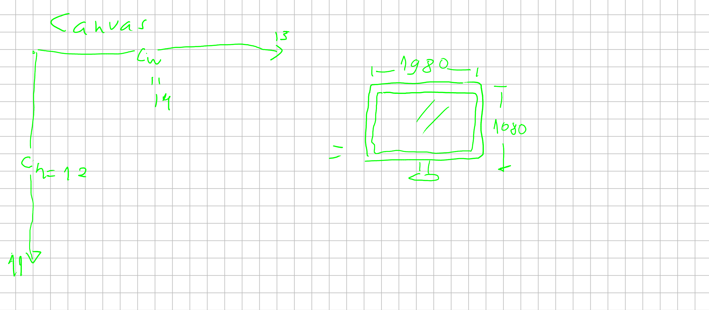

_(A small fix to the drawing above: a Full HD monitor is 1920×1080, not 1980×1080.)_

So we are going to start with a method `canvas.putPixel(positionX, positionY, color)`, which puts a pixel at a specified position with a particular color.

But we must understand that, because the canvas works as a matrix, the way we access it is not like a Cartesian map. `(0,0)` is not the center of the screen, but the top-left corner of the canvas.

Usually graphics developers prefer to work with a Cartesian representation of the screen, because it's easier to wrap your mind around it. We can think about this translation as a map, which we want our `putPixel()` procedure to do for us.
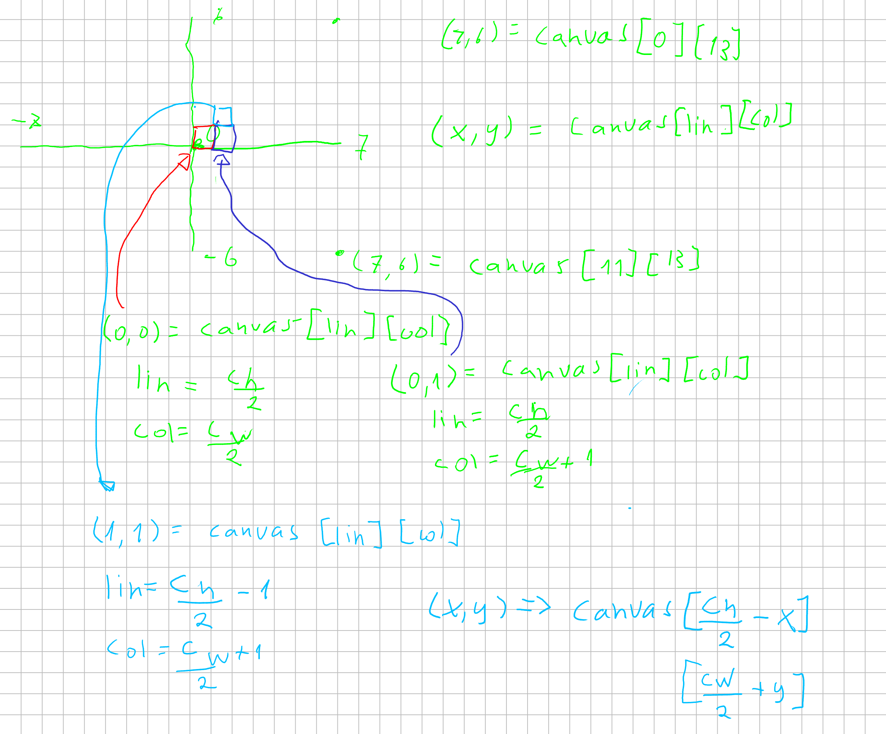
Which, if you think about it, is pretty simple: we want a call to `putPixel(x, y, color)` with `(x: 0, y: 0)` to write a pixel at the center of the screen instead of its top-left corner.
So we shift $$x$$ by half the width, and for $$y$$ we flip its direction (on the screen $$y$$ grows downwards) and shift it by half the height:

$$
S_x = \frac{C_w}{2} + x \qquad S_y = \frac{C_h}{2} - y
$$

where $$C_w$$ and $$C_h$$ are the canvas width and height. In matrix notation (row first, then column) that is `canvas[Ch/2 - y][Cw/2 + x]`.

_Fix to the drawing above: its final formula has $$x$$ and $$y$$ swapped, and the cell it labels "(0,1)" is actually $$(1,0)$$. The correct access is `canvas[Ch/2 - y][Cw/2 + x]`. Also, a canvas with an even width has one more column on one side than on the other: with $$C_w = 14$$, $$x$$ goes from $$-7$$ to $$6$$._

I propose this "translation" here already to get you familiar with the many translations we are going to do during this text.

### How are we going to draw anything?

With our blade called `putPixel` we are now ready to start drawing on the screen. But how can we draw three-dimensional figures onto the screen?
Well, let's think about how light works for a second.

A light source emits light that hits a surface; the surface absorbs some colors and reflects all the others (duh!), and those reflected rays reach your eyes and inform your brain.

We could write an algorithm that achieved the same behaviour, but a simple 100 W lightbulb emits on the order of $$10^{20}$$ photons per second. A common processor peaks at around $$3.0\ GHz$$, which means roughly $$3 \times 10^9$$ instructions executed each second. Even though it may seem a big number, it is tiny compared to the number of photons a simple lightbulb emits — and almost none of those photons ever reach your eyes.

So simulating light that way is not feasible with current technology. So, how else can we simulate it?

Well... let's do it in reverse!
Imagine that we want to cast only the light rays that actually reach our eyes.
Then, imagine light rays leaving your eyes, reaching an object and then reaching the light source. We just need those rays.
That is raytracing!

So how can we achieve that?
We need to think about how we are going to cast those rays in three-dimensional space and how to translate that to our screen.

Imagine that we are painters: we have a canvas in front of us. And imagine that this canvas is "discrete". By discrete I mean: this canvas is a grid, where in each cell you can put just one color.
To paint onto this canvas the scene behind it, you would look through each grid cell, see what color corresponds to it, and then put that color onto the canvas. After repeating that for every cell you would have a "discrete" picture of what you decided to paint. We want to replicate this technique here.

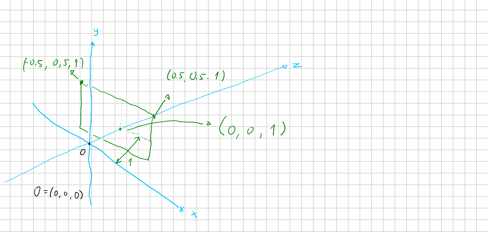

We want to create a three-dimensional space and then translate it to our two-dimensional discrete screen.

Let's imagine the Cartesian coordinate system with three axes $$(x, y, z)$$ we all know from school. Imagine your eye is at the origin $$O(0,0,0)$$, looking towards $$+z$$.
In order to replicate the painter's canvas, we want a plane $$P$$ to know "where" we are looking for the color.
So imagine that this plane is one unit away from our eyes, and that it is one unit wide and one unit tall (from $$-0.5$$ to $$0.5$$ in $$x$$ and in $$y$$). We call this rectangle the *viewport*.

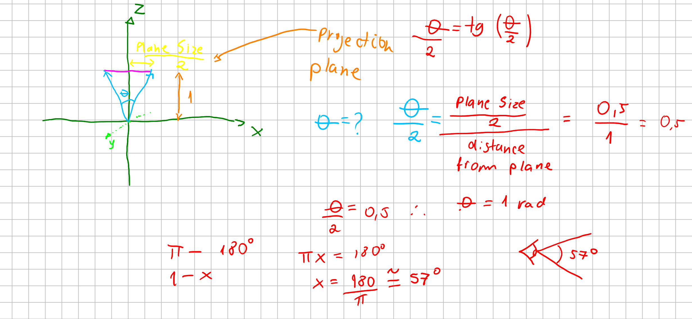

What we want to achieve is: somehow cast a line from the origin through specific points of our plane $$P$$ and see where it lands. If it lands on anything, for now, we want to know its color.

A viewport $$1$$ unit wide at a distance of $$1$$ unit gives us a field of view $$\theta$$ such that $$\tan\frac{\theta}{2} = \frac{0.5}{1}$$, so $$\theta = 2 \arctan(0.5) \approx 53°$$.

_Fix to the drawing above: it uses $$\frac{\theta}{2} = \tan\frac{\theta}{2}$$, which is only an approximation for small angles and gives $$\theta = 1\ rad \approx 57°$$. The exact value is $$2\arctan(0.5) \approx 53.13°$$._

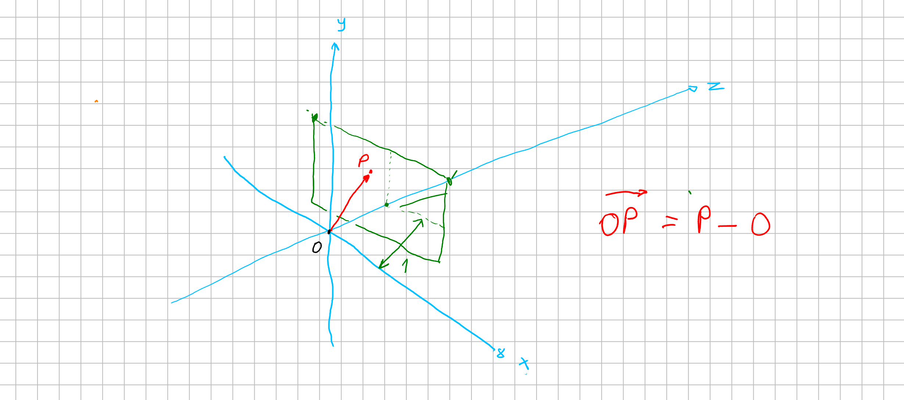

Now we need a way to map a pixel of our screen to a point $$p = (x, y, z)$$ on $$P$$. Since the canvas has $$C_w \times C_h$$ pixels and the viewport has $$V_w \times V_h$$ units, it is just a change of scale (using the centered pixel coordinates from `putPixel`):

$$
V_x = C_x \cdot \frac{V_w}{C_w} \qquad V_y = C_y \cdot \frac{V_h}{C_h} \qquad V_z = d
$$

where $$d = 1$$ is the distance from the eye to the plane. For example, on a $$400 \times 400$$ canvas, the pixel $$(100, -50)$$ maps to $$(0.25, -0.125, 1)$$, and the canvas edges ($$\pm 200$$) map to the viewport edges ($$\pm 0.5$$). If the canvas is not square, the viewport shouldn't be either — otherwise the image gets stretched.

With that point we can calculate a vector from our origin $$O$$ to that point $$p$$ with $$ \vec{v} = p - O = (x, y, z) - (0, 0, 0) = (x, y, z) $$.
Now we have a vector that goes from the origin through the plane $$P$$. This vector is our "photon".
We can think of a scalar $$\lambda$$ such that $$O + \lambda \vec{v}$$ describes our photon stretching across our world: $$\lambda = 1$$ is exactly the point on the plane, and $$\lambda > 1$$ is everything beyond it.

But how can we know if this photon has collided with something?

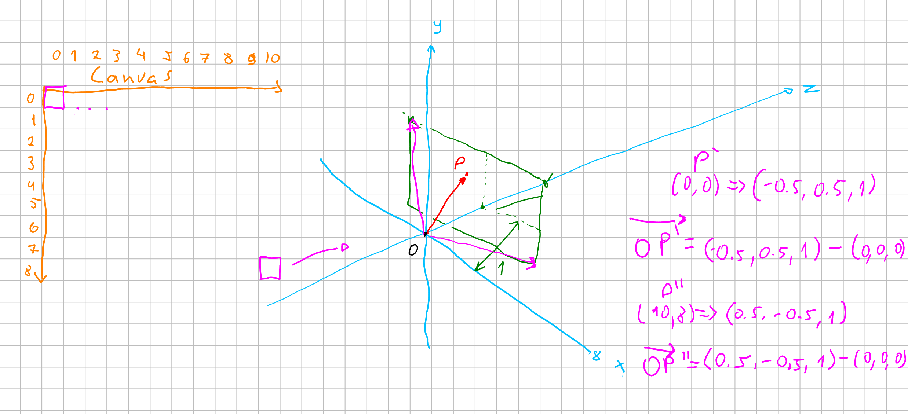


## Calculate hit!

Most three-dimensional objects today are meshes of triangles.
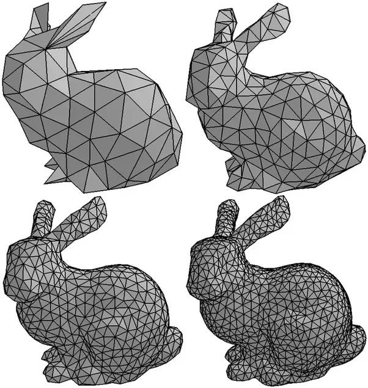

So in order to render this three-dimensional bunny (the [Stanford Bunny](https://graphics.stanford.edu/data/3Dscanrep/)), we would have to calculate whether our ray $$\lambda \vec{v}$$ hit the surface of one of the triangles.
This means solving a "line meets surface" equation.

To illustrate that, we are going to start with a simpler example: colliding with a sphere. A sphere is easier to define than a mesh of triangles, at least for now. To define it, we need one simple equation.

Then, to check if our photon collided with our sphere, we just have to find the scalar $$\lambda$$ that makes the point $$\lambda\vec{v}$$ a point of our sphere. In other words: we want to find a root that gives us a point on the sphere.


### Let's be a bit mathy

We define a sphere as a structure where all points have the same distance from the center. This distance we call the radius.
$$distance(\text{all points}, center) = radius$$

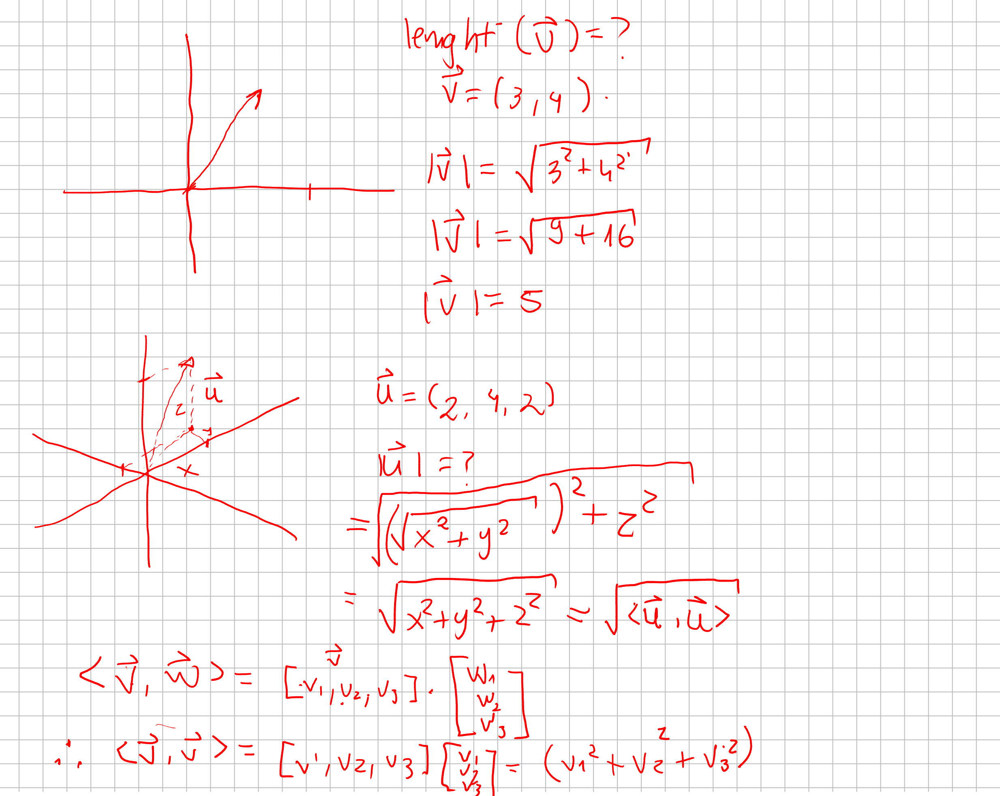

As you can see, we can describe the length of a vector $$\vec{u} = (x, y, z)$$ as $$|\vec{u}| = \sqrt{x^2 + y^2 + z^2} = \sqrt{\langle\vec{u} , \vec{u}\rangle} $$. For the example in the image, $$\vec{u} = (2, 4, 2)$$ has length $$\sqrt{4 + 16 + 4} = \sqrt{24} \approx 4.9$$.
Given that definition, we can define a sphere: given a center $$C$$, a sphere is the set of points $$P$$ which are at a distance $$r$$ (the radius) from $$C$$.

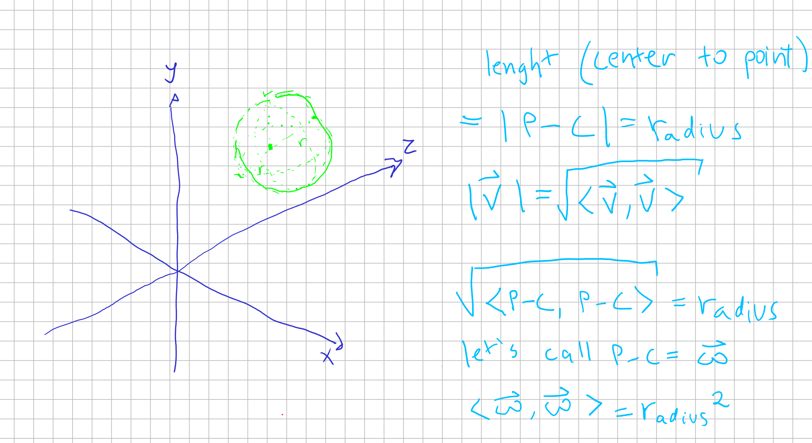

So now we have an equation for our "ray", cast from our origin through a pixel of the screen, and an equation for a sphere in our world. Everything else is given, so we just need to compute which value of $$\lambda$$ makes our ray $$O + \lambda \vec{v}$$ equal to a point on our sphere.

We want a point that is both on the line and on the sphere's surface. So we substitute $$P$$ in our sphere equation with our ray equation.

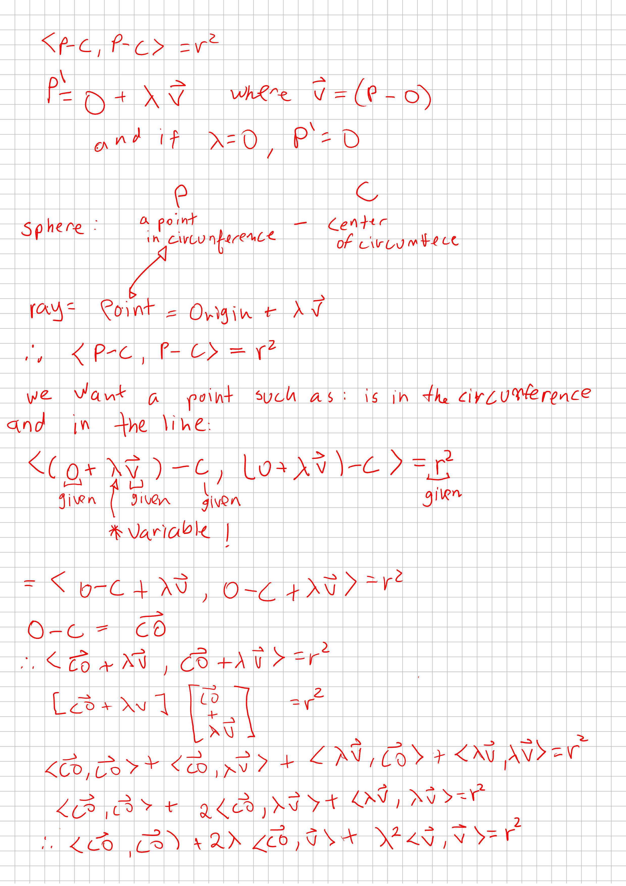

That is a second-degree equation in $$\lambda$$, so it can have two, one or zero solutions. And that makes sense geometrically! A ray can cross the sphere (entering at one point and leaving at another), touch it at a single point (a tangent line), or miss it completely.

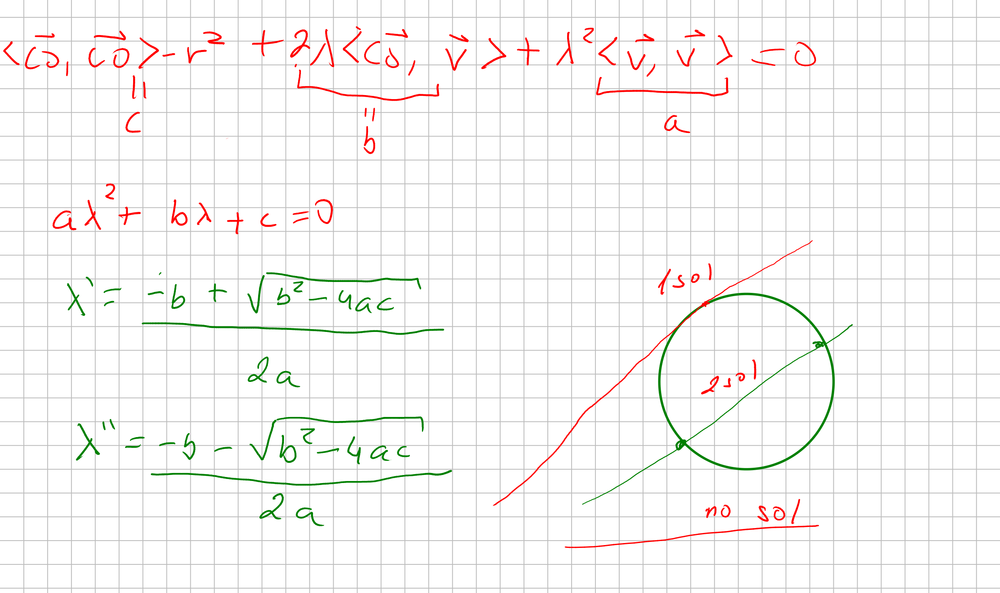

Written as $$a\lambda^2 + b\lambda + c = 0$$, the coefficients are:

$$
a = \langle \vec{v}, \vec{v} \rangle \qquad b = 2\langle \vec{CO}, \vec{v} \rangle \qquad c = \langle \vec{CO}, \vec{CO} \rangle - r^2
$$

with $$\vec{CO} = O - C$$. _(In the drawing above, the brace for $$b$$ also covers the $$\lambda$$, and the brace for $$c$$ leaves out the $$-r^2$$; the formulas above are the correct ones.)_

Let's check if our equations make sense!
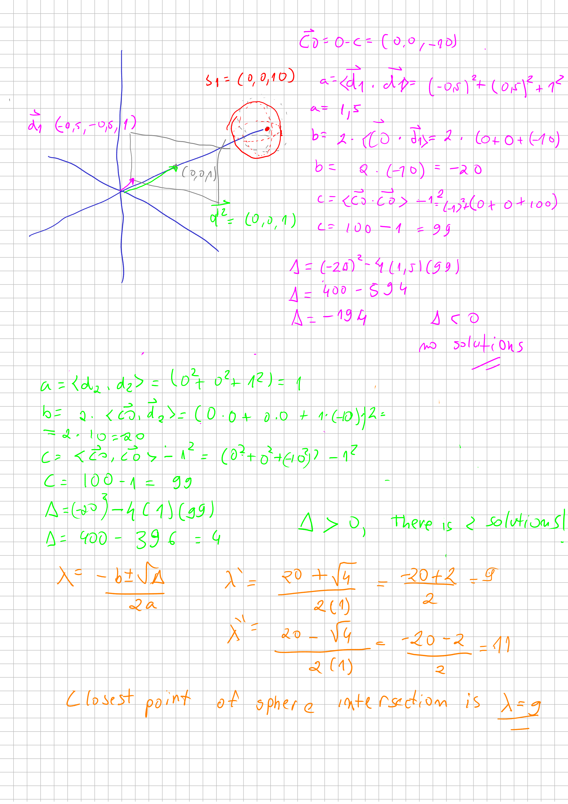

_Fix to the second example above: with $$C = (0, 0, 10)$$ and $$\vec{v} = (0, 0, 1)$$ we have $$\vec{CO} = (0, 0, -10)$$, so $$b = 2 \cdot (-10) = -20$$ (not $$20$$). Then $$\Delta = 400 - 396 = 4$$ and_

$$
\lambda = \frac{-b \pm \sqrt{\Delta}}{2a} = \frac{20 \pm 2}{2} \Rightarrow \lambda' = 11, \quad \lambda'' = 9
$$

_The ray enters the sphere at $$\lambda = 9$$ (the point $$(0, 0, 9)$$) and leaves at $$\lambda = 11$$. The visible point is the closest one, $$\lambda = 9$$. Note that, since $$a > 0$$, the root with $$-\sqrt{\Delta}$$ is always the smaller one._

### Let's code this!

I'm going to implement this raytracing algorithm in JavaScript, but you could follow along in any language.
Notice that the only thing we are going to draw for now is the sphere's silhouette: a flat disc, without proper lighting and illumination.

So let's see our pseudo-code top-down. Let's start from the global procedure that computes each pixel and then specialize the functions until we reach our `ray-sphere` computation.

```
for each pixel (x, y) of the screen:
	direction <= map pixel position to viewport position
	hit_object <= cast_ray(origin, direction, world)

	if hit_object is not null:
		pixel color <= hit_object.color
	else:
		pixel color <= background.color
```

For each pixel, this procedure maps the screen position to our "plane" position. Then we cast a ray from the origin through that plane position.
If we intersect anything, we color that pixel with the object's color; otherwise we paint it with the background color.


Our `cast_ray()` procedure is going to call the intersection with spheres, planes, triangles... but for now we only have spheres.
Because our program is still a simple one, our camera doesn't move. We set a global variable `PLANE_DISTANCE <= 1` so we only accept solutions beyond our projection plane ($$\lambda > 1$$), and we keep the closest one:

```
cast_ray(origin, direction, world):
	closest_t <= infinity
	closest_sphere <= null

	for each sphere in world:
		[t1, t2] <= intersect_sphere(origin, direction, sphere)

		if t1 > PLANE_DISTANCE and t1 < closest_t:
			closest_t <= t1
			closest_sphere <= sphere

		if t2 > PLANE_DISTANCE and t2 < closest_t:
			closest_t <= t2
			closest_sphere <= sphere

	return closest_sphere
```

Notice the two independent `if`s: we have to test both solutions, because either one may be the closest.

Finally, let's compute whether there is any solution.
It is just the quadratic formula (in Brazil we call it Bhaskara's formula), with the coefficients computed from the vectors:

```
intersect_sphere(origin, direction, sphere):
	center_to_origin <= origin - sphere.center

	a <= direction.dot(direction)
	b <= 2 * center_to_origin.dot(direction)
	c <= center_to_origin.dot(center_to_origin) - sphere.radius * sphere.radius

	delta <= b * b - 4 * a * c

	if delta < 0:
		return [infinity, infinity]

	solution1 <= (-b + sqrt(delta)) / (2 * a)
	solution2 <= (-b - sqrt(delta)) / (2 * a)
	return [solution1, solution2]
```

And that, my friends, should do the trick to render the spheres on your screen:



If you add another sphere, you should expect the spheres to be rendered in front of each other properly:
```javascript
    {
      center: new Vector3f(1, -1, 7),
      radius: 1,
      color: { r: 0, g: 255, b: 0, a: 255 },
    },
```

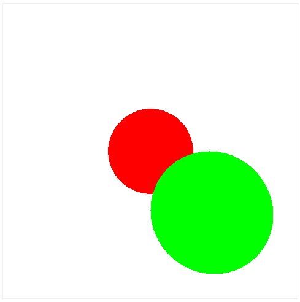

## What is next
Next we are going to render lighting effects. And after that we will be ready to render triangles and display three-dimensional meshes with custom shapes!
See you next time!

You can access the source code here: https://github.com/lrdass/cns

## References

- Gabriel Gambetta, [*Computer Graphics from Scratch: A Programmer's Introduction to 3D Rendering*](https://gabrielgambetta.com/computer-graphics-from-scratch/), No Starch Press, 2021. This text follows the structure of its raytracing part (canvas, viewport at distance 1, ray–sphere intersection), and the book is free to read online.
