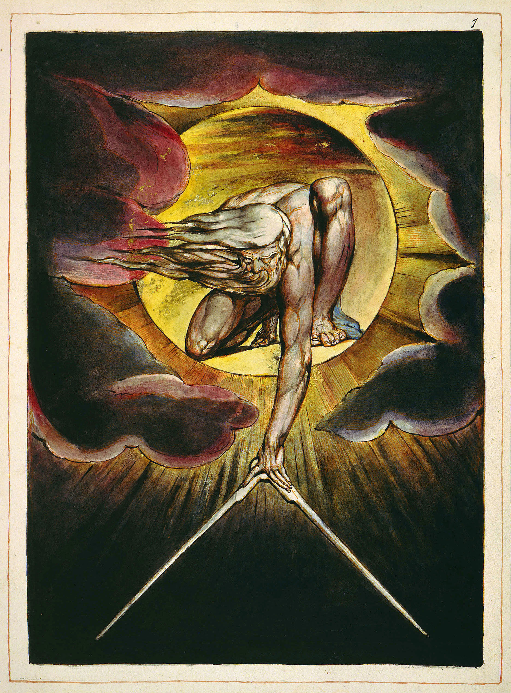
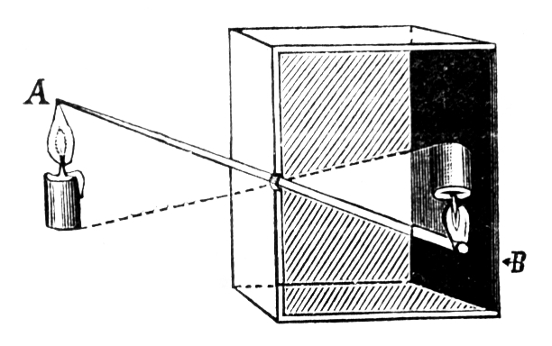
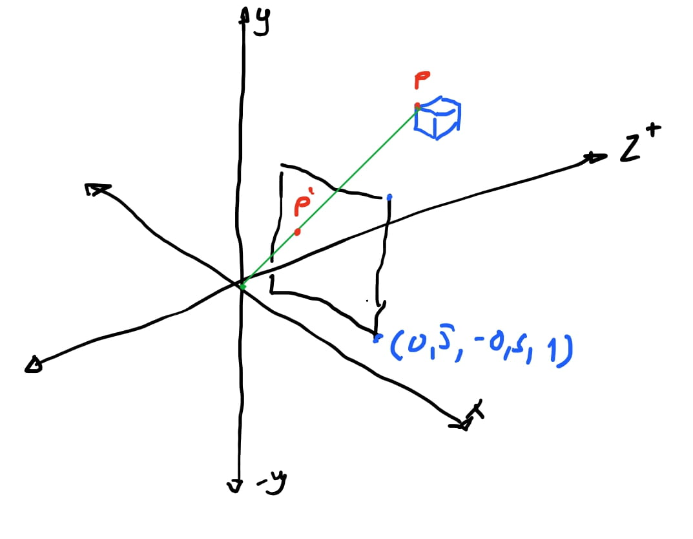
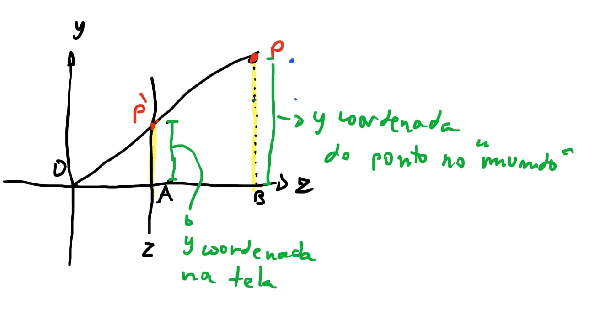
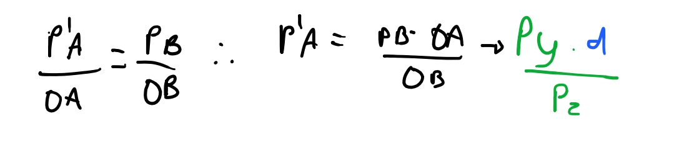
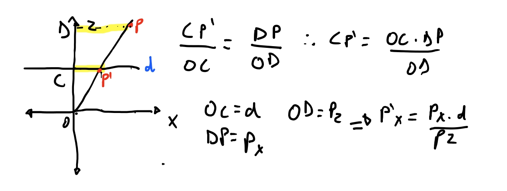
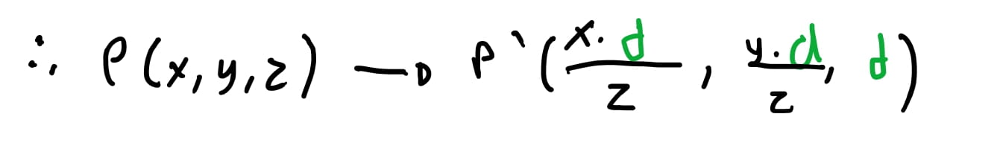
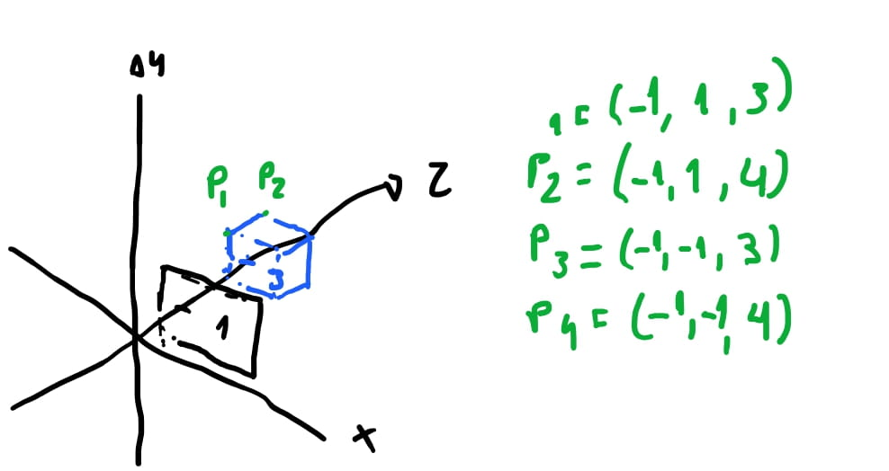
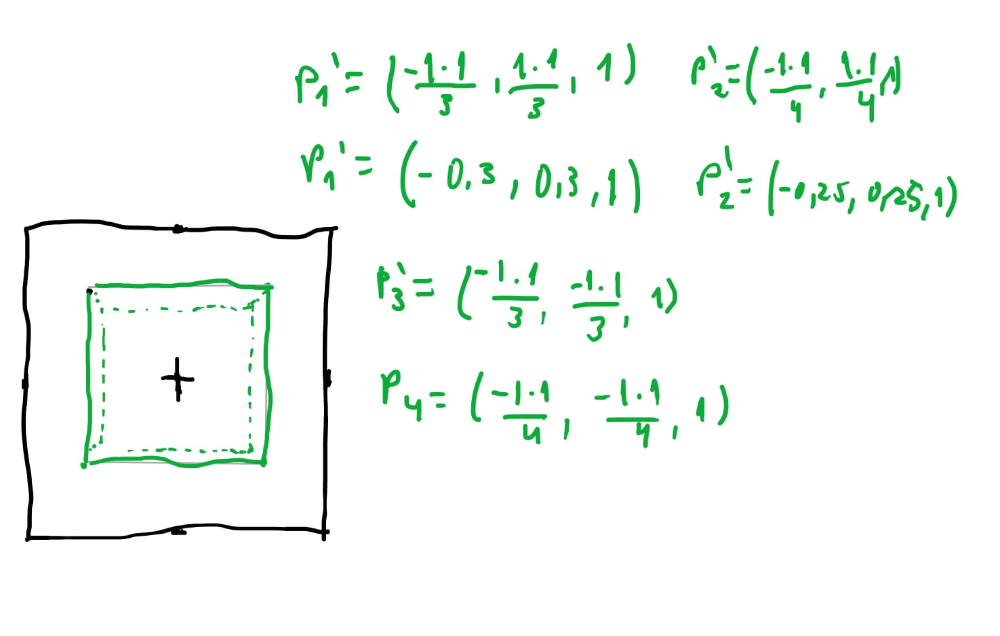
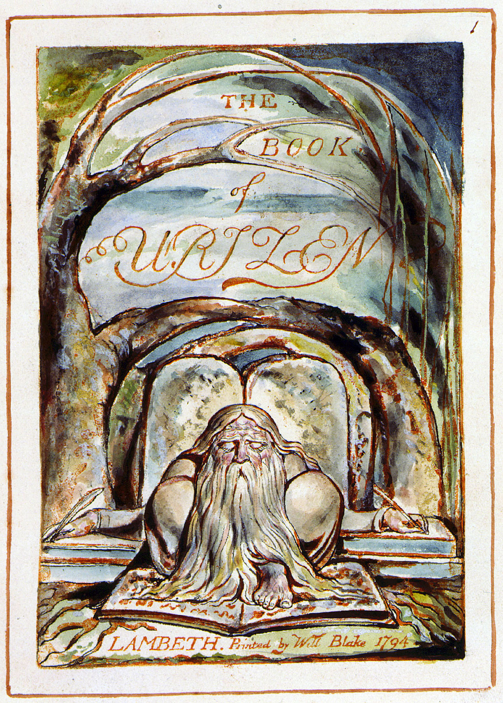

>"Por vezes e vezes ele dividiu, e mediu<br>
> espaço por espaço em sua nove vezes escuridão,<br>
> o não visto, o não conhecido, as mudanças apareceram<br>
> como montanhas desoladas, racharam furiosas<br>
> pelos ventos escuros da pertubação"<br>
> tradução livre do primeiro capitulo do livro de Urizen de William Blake

Em algum momento imaginei que eventualmente citaria William Blake. E em particular um de seus personagens de sua cosmogonia pessoal: Urizen.
William Blake foi, se me permitem resumir seus feitos, um pintor e poeta inglês que viveu uma época de instabilidade religiosa na Inglaterra. Como os ingleses não seguiam os preceitos católicos vindos do Vaticano desde a rebelião de Henrique VIII o povo inglês era uma amalgama de vários grupos cristãos e cada grupo com a sua própria visão e valores do que era ser cristão.

Blake não era diferente dos demais ingleses. Tido por muitos como peculiar (talvez um eufemismo para o que alguns chamariam de loucura) ele afirmava que tinha visões e vislumbres de realidades mais sensíveis do que nós, indivíduos com menor capacidade visual/espiritual, apenas podemos conjecturar. Para nossa sorte Blake pintou e escreveu todas suas ideias e visões. E nesse processo criou sua própria cosmogonia e seu próprio panteão de personagens que prototipavam os arquétipos do ser humano, e por extensão, da realidade em sí.

Então voltamos ao homem da pintura acima. Ele é Urizen. Na cosmogonia de Blake é o lado racional do homem. Urizen, ou a razão, quando nasce e ve a sí própria, acredita que ela foi o motivo em sí mesma, e logo, não existe nada além dela. Então Urizen conclui que tudo ao seu redor deve nascer de sí.

Então caros amigos, criarmos um mundo tridimensional em um equipamento que usa apenas a lógica é onde exercemos a maior óde a Urizen possível. Aqui é onde estamos começando uma aventura em ideias de como simular a física de nosso mundo e até de compreender como a logica do próprio universo funciona para capturar essas ideias e representar em uma linguagem lógica que nossas maquinas de Turing consigam resolver e acender as cores certas na tela.

## Do que você está falando ?
Neste texto nós vamos começar a representar figuras tridimensionais. Para isso vamos ter uma interpretação do espaço do mundo simulado e do espaço bidimensional da tela. E encontrar uma forma de identificar o que está na tela da câmera e, por fim, projetar o mundo tridimensional na tela.
Estas ideias são a base da computação gráfica. E os algoritmos podem suscitar ideias sobre a simulação da realidade, o quão longe podemos ir e quais as restrições. Então vamos colorir nossas ideias e saber o que em nós esta assumindo o controle quando estamos no papel de criar um universo em nossas próprias mãos. Um spoiler: na cosmogonia de Blake, Urizen não necessariamente é o bonzinho da história.

Então como vai funcionar ? Bom nós queremos ter objetos com três dimensões em um espaço tridimensional e queremos ter alguma forma de filma-los, ou seja, alguma forma de saber quais objetos e/ou quais partes desses objetos estão na nossa tela.
Então... vamos pensar em uma câmera. Imagine que teremos uma câmera onde o que ela captura na verdade vai ser nossa tela.

No [post anterior](https://tomatofractal.io/rasterizer/2021/12/15/rasterizer-from-scratch.html) nós chegamos na caneta de Urizen. Neste post vamos elaborar o esquadro e a régua.



Uma câmera funciona como o [experimento da câmara escura][1]. Em que a fotografia ou o video é capturado dentro da câmera.
Podemos reproduzir o experimento da câmera escura simplificado, onde o plano onde a luz vai ser projetada vai ser um plano conhecido, e esse plano vai ser a nossa tela.
Na câmara escura a imagem se forma invertida, atrás do furo. No nosso modelo vamos colocar o plano *na frente* do olho, entre o olho e os objetos: a conta é a mesma, mas a imagem sai na posição certa, sem inversão.

A ideia para descobrir isso vai ser com um pouquinho de geometria. Mas o que queremos procurar é qual o ponto $$P'$$ no plano de projeção para um ponto $$P$$ no mundo. E vamos fazer essa pergunta para todos os pontos do mundo. Os pontos que estiverem dentro do intervalo da nossa tela $$[-0.5, 0.5]$$ em $$x$$ e $$[-0.5, 0.5]$$ em $$y$$. Dai com a nossa tela com vários pontos dos nossos polígonos tridimensionais, vai bastar fazer um mapeamento dos pontos `tela->monitor` que funcionaria como mapear $$[-0.5, 0.5] \Rightarrow [0, 1920]$$ pixels para a largura e o mesmo para a altura. E com isso teremos o suficiente para projetar pontos tridimensionais para a nossa tela.

```
projetaObjetoTridimensional(objeto):
  para cada objeto no mundo:
    para cada ponto do objeto
      projete o ponto no plano

    desenhe linhas entre os pontos projetados
```


Vamos usar a cena acima: temos um cubo na cena, e temos um plano centralizado em $$z_+$$, e a uma distancia $$d = 1$$.

Então vamos pensar como podemos obter $$P'$$. Se olharmos a nossa cena de forma que o eixo $$y$$ fique pra cima e o eixo $$z$$ para a direita e o $$x$$ na nossa direção, vemos que  foma um triangulo com a reta que liga a origem $$O(0,0,0)$$ cruzando o nosso plano de projeção $$proj$$.


🤔 se queremos calcular o ponto $$P'$$, podemos ver que o valor da sua $$y$$-coordenada  é o segmento $$\overline{P'A}$$(para ser mais correto: é o valor do segmento $$\overline{P'A}$$ projetado no eixo $$y$$).Sabemos também que o valor da sua $$z$$-coordenada é a mesma da distancia plano $$proj$$ da origem.
Se usarmos a proporção do triangulo de que $$\frac{\overline{P'A}}{\overline{OA}} = \frac{\overline{PB}}{\overline{OB}}$$ então podemos chegar que $$\overline{P'A} = \frac{\overline{OA} \cdot \overline{PB}}{\overline{OB}}$$.

E sabemos todos os valores que vamos precisar nessa equação: $$\overline{PB}$$  é o valor da $$y$$-coordenada do ponto $$P$$. O valor $$\overline{OA}$$ é a distancia do plano de projeção da nossa origem no eixo $$z$$, portanto, $$d$$. E por fim o valor de $$\overline{OB}$$ é a $$z$$-coordenada do ponto $$P$$. Então temos:



Para o eixo $$x$$ vamos ter a reciproca! Só que dessa vez vamos olhar como se olhássemos a nossa cena de cima. Com o eixo $$z$$ para cima, o eixo $$x$$ para os lados e o eixo $$y$$ como se tivesse apontado para nós.




Chegamos em uma equação bem similar, porem considerando a $$x$$ coordenada. Agora sabemos encontrar a posição de um ponto qualquer no mundo projetado no nosso plano de projeção. Vamos testar para ver se acontece como planejado!





Vamos supor que nosso plano de projeção esteja a uma distancia de $$d = 1$$  do eixo $$z$$. Isto é, imagine que o centro do plano esteja em $$proj = (0,0,1)$$. E imagine que temos um cubo que tenha os oito pontos à duas unidades na frente do nosso plano e tenha alguns dos pontos: $$P_1(-1, 1, 3)$$,$$ P_2(-1, 1, 4)$$, $$ P_3(-1, -1, 3)$$, $$P_4(-1, -1, 4)$$, $$...$$.



Se acompanhar as contas acima e desenhar os pontos que encontramos, os pontos que estiverem dentro do intervalo de nosso plano de projeção $$[-0.5, 0.5]$$ vão ser desenhados. E podemos conferir, como desenhamos à esquerda, que nosso algoritmo funciona! Podemos conferir que $$P_1(-1, 1, 3) \Rightarrow (-\frac{1}{3}, \frac{1}{3}, 1) \approx (-0.33, 0.33, 1)$$ (na imagem o valor aparece arredondado para $$0,3$$).
Uma percepção da nossa visão é que realmente quanto mais longe as coisas estão de nós, menor elas parecem ficar. Então faz sentido os nossos cálculos dividir por $$z$$ ou seja a distancia da origem que o objeto está do observador, menor parece ficar ... o tamanho aparente é inversamente proporcional à distancia do observador 😅.

# hora de implementar !

Então agora que temos as equações nas mãos e vemos que funciona, é hora de transformar em código. Então o que queremos fazer é descrever a nossa cena, colocando onde está nosso plano de projeção, e o nosso cubo. Vamos então mapear os pontos da nossa cena, para as coordenadas do plano. Com essas coordenadas no nosso plano, vamos mapear elas para os pixels da tela e por fim, desenhar as linhas entre cada ponto.
Devemos perceber então que as linhas são desenhadas na tela, e não no "plano de projeção".

No código abaixo os vértices estão numerados de outra forma que nas imagens: primeiro os quatro da face da frente ($$z = 3$$), na ordem em que contornamos a face, e depois os quatro da face de trás ($$z = 4$$), na mesma ordem. Assim, ligar cada vértice ao próximo desenha o contorno da face, e não uma diagonal.

```
plano_projeção:
  | distancia => d
  | largura, altura => plano_largura, plano_altura

cubo:
  | vértice1 = (x:-1, y:1, z:3)
  | vértice2 = (x:1, y:1, z:3)
  | vértice3 = (x:1, y:-1, z:3)
  | vértice4 = (x:-1, y:-1, z:3)

  | vértice5 = (x:-1, y:1, z:4)
  | vértice6 = (x:1, y:1, z:4)
  | vértice7 = (x:1, y:-1, z:4)
  | vértice8 = (x:-1, y:-1, z:4)

função map_projeção->tela (x, y, z):
  retorne {
    x : x * (largura_da_tela / plano_largura),
    y: y * (altura_da_tela / plano_altura)
  }

função projetar_ponto(x, y, z):
  return {
    x: (x * d) / z,
    y: (y * d) / z,
  }

```
Com essas funções e os vértices do cubo, agora basta que liguemos cada cubo, desenhando as arestas dos cubos chamando a função de `desenhar_linha` que vimos no post anterior.
Então vamos ligar cada aresta manualmente:

```
// p1 -> p2
desenhe_linha(
  map_projeção->tela(
    projetar_ponto(vértice1)
  ),
  map_projeção->tela(
    projetar_ponto(vértice2)
  )
)
// p2->p3
desenhe_linha(
  map_projeção->tela(
    projetar_ponto(vértice2)
  ),
  map_projeção->tela(
    projetar_ponto(vértice3)
  )
)
// p3->p4
desenhe_linha(
  map_projeção->tela(
    projetar_ponto(vértice3)
  ),
  map_projeção->tela(
    projetar_ponto(vértice4)
  )
)
// p4->p1
desenhe_linha(
  map_projeção->tela(
    projetar_ponto(vértice4)
  ),
  map_projeção->tela(
    projetar_ponto(vértice1)
  )
)
...
// desenhe linhas entre as arestas do cubo
```
E assim faremos para todas as arestas: as quatro da face da frente, as quatro da face de trás ($$5 \rightarrow 6 \rightarrow 7 \rightarrow 8 \rightarrow 5$$) e as quatro que ligam uma face à outra ($$1 \rightarrow 5$$, $$2 \rightarrow 6$$, $$3 \rightarrow 7$$, $$4 \rightarrow 8$$).

## segue a nossa implementação



###  o que escondemos ?



Acabamos não falando de angulo de visão ou porque desenhamos as linhas em alguma ordem específica. O tamanho e a posição do plano vai dizer qual angulo de visão a câmera terá. Também assumimos que todos os pontos estão na frente da câmera ($$z > 0$$): um ponto com $$z = 0$$ faria a projeção dividir por zero, e um ponto atrás da câmera ($$z < 0$$) apareceria invertido na tela. Resolver isso é o trabalho do *clipping*, que fica para outro texto. Até agora apenas esbarramos na superfície da computação gráfica, mas já temos uma boa ideia de como a matemática da projeção funciona. E isso vai nos dar alguma liberdade para nos próximos textos pensarmos apenas como podemos estender este exemplo para gráficos mais abrangentes. Vamos falar de como podemos criar objetos tridimensionais quaisquer e movimenta-los pelo mundo tridimensional.

Agora que temos ambos esquadro e caneta, Urizen vai poder criar seu mundo de razão. Nos poemas de Blake, Urizen, ou a razão humana, vagueia por ai dando nomes e dividindo as coisas para entende-las. E esse é apenas o nosso começo do poema. Em um ponto do poema, Urizen se encontra acorrentado pelas correntes de Los, o principio criativo da mente humana. Somente então Los cria uma imagem humana de Urizen, e a união perfeita do homem com a sua Razão (Urizen) e sua Imaginação (Los) cria o homem perfeito Albion. Até chegarmos ao fim de um rasterizador completo e finalmente Urizen ver a si isolado no seu próprio mundo vazio e acorrentado pela própria criação é que daremos espaço para Los nascer e conseguiremos deixar com que a nossa criatividade embelezar nosso mundo tridimensional de árvores, arte e musica. Mas não se deixem enganar: ainda é um mundo artificial de Urizen!

## Referências

- Gabriel Gambetta, [*Computer Graphics from Scratch: A Programmer's Introduction to 3D Rendering*](https://gabrielgambetta.com/computer-graphics-from-scratch/), No Starch Press, 2021. A sequência desta série segue de perto a parte de rasterização desse livro, que pode ser lido de graça online.
- James D. Foley, Andries van Dam, Steven K. Feiner e John F. Hughes, *Computer Graphics: Principles and Practice*, Addison-Wesley. O livro clássico da área, para quem quiser se aprofundar em cada um dos tópicos da série.

[1]: https://pt.wikipedia.org/wiki/C%C3%A2mera_escura
