O seculo XX foi marcado de várias mudanças sociais, cientificas e estruturais pro mundo inteiro. Impérios deixaram de existir para dar berço as sociedades democráticas, o mundo deixou de girar em torno da Inglaterra, a ciência deixou de ser absoluta para ser relativa, a arte questionou a sí mesma e "o que é arte?". Um dos grandes eventos do seculo XX foi a segunda guerra mundial e os seus impactos. Na tentativa de quebrar a criptografia alemã, um jovem matemático de nome Alan Turing levou para Bletchley Park as ideias da sua teoria da computabilidade e ajudou a construir as máquinas que quebravam as mensagens cifradas pela máquina Enigma. Ele havia desenvolvido essa teoria alguns anos antes, em 1936, para responder ao *Entscheidungsproblem* (o "problema da decisão"), proposto por David Hilbert e Wilhelm Ackermann em 1928 como parte do programa de Hilbert de formalizar a matemática de forma definitiva. A pergunta era: "existe um algoritmo capaz de decidir se qualquer declaração matemática é verdadeira ou falsa?". Turing então definiu formalmente o que é um algoritmo e como computá-lo, e provou que tal algoritmo não pode existir. E então essa teoria de maquinas foi dada o seu nome conhecidas hoje com "Maquinas de Turing", e são a base da computação moderna.

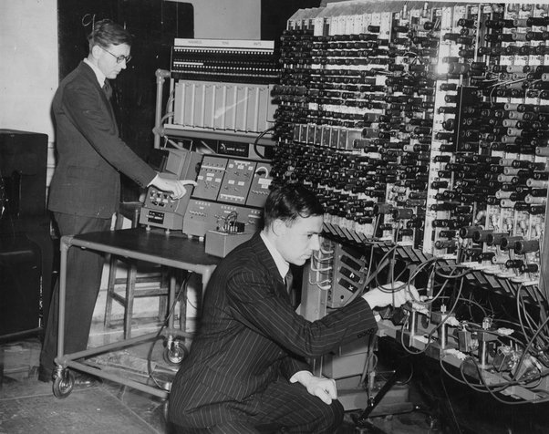

Ao fim da segunda guerra mundial, a URSS começou seu próprio programa nuclear, assim como os Estados Unidos importou algumas mentes por trás dos foguetes V2 que eram usados para bombardear a Inglaterra. E a guerra fria começa: com o pretexto de conquistas espaciais, era o plano de fundo para uma guerra que acontecia apenas no campo mental: Uma guerra tecnológica pela influencia politica sobre o mundo. Quem conseguisse dominar a tecnologia dos foguetes intercontinentais estaria em grande vantagem cientifica sobre o outro. Esta vantagem seria tão absurda que permitiria uma constante vigilância do globo. Então as duas superpotências corriam para desenvolver os melhores foguetes possíveis. E para demonstrar a superioridade tecnológica estavam fazendo feitos espaciais de demonstração de força. Quem conseguisse colocar um satélite implicava na habilidade de sondar qualquer parte do globo: e isso era claro no medo dos estado unidenses acreditando que o Sputnik, o primeiro satélite em orbita, estivesse sondando ou atacando os americanos com ondas radioativas.

Mas a ideia era clara: o objetivo de ambos era conseguir acertar "precisamente" um alvo em qualquer lugar do mundo com um ogiva nuclear. A corrida espacial, portanto, não passou de um pano de fundo pra uma corrida armamentista de misseis balísticos transcontinentais. E as Maquinas de Turing foram essenciais novamente nesse conflito. O que antes foi usado para terminar uma guerra, agora estava sendo usado para guiar os misseis.
Então o programador completamente versado no idioma das maquinas tem o poder de decidir se é quem guia os foguetes ou quem termina guerras.

Nestes últimos conjuntos de textos estamos criando um mundo tridimensional na mesma Maquina de Turing. Aqui estamos escolhendo então como criar ao invés de destruir. E neste vamos fazer nossa Maquina de Turing a entender o que são as três dimensões, e para isso, vamos precisar de algumas ferramentas matemáticas. Vamos precisar declarar para nossa maquina como ela pode "entender" o que são as três dimensões, o que é um ponto, como saber onde este ponto está no espaço e como podemos mover estes pontos no espaço. E por fim, como podemos "projetar" esse espaço tridimensional da memoria do computador para a tela para que podemos "ver" o nosso mundo digital.

No post anterior vimos como desenhar um objeto tridimensional com perspectiva, dada uma representação de uma figura tridimensional. Apresentamos apenas a matemática por trás da ideia. Para irmos além aquele método apresenta alguns problemas:
* Não conseguimos desenhar qualquer objeto tridimensional com o método, por exemplo, esferas. Pois o algoritmo depende de decompor em linhas
* Toda vez que fossemos criar um objeto em cena, precisaríamos dizer qual a ordem dos desenhos de cada aresta. E não só isso: A câmera precisa ficar estacionada em $$(0,0,0)$$.
* Se fossemos criar outro cubo, repetiríamos todo o cubo, porem, movendo cada aresta 😩

Então pensando nestes problemas vamos criar uma forma melhor de descrever os objetos tridimensionais e como podemos criar abstrações para desenha-los na tela.

# Descrevendo a cena tridimensional

Ok, vamos bolar algum jeito de resolver os problemas citados.
Vamos começar em: como podemos desenhar qualquer figura tridimensional usando a nossa técnica de projeção.

No exemplo anterior para desenhar um cubo nós desenhamos aresta por aresta. Isso é um pouco limitante porque teríamos que saber como reduzir todas as figuras em retas.
Para contornar isso, e automatizar nosso algoritmo para desenharmos qualquer coisa com a mesma equação de projeção que chegamos anteriormente, podemos pensar em reduzir todas as formas em figuras mais simples!

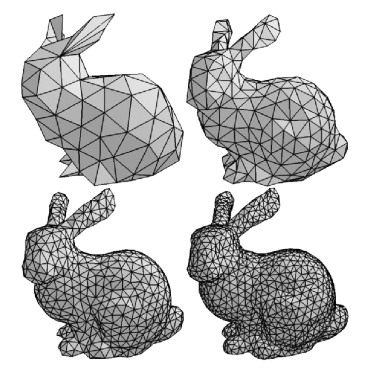

Então e se reduzirmos tudo à triângulos? Triângulos são simples de representar e desenhar. São os polígonos mais simples e todos os pontos estão sempre no mesmo plano! [Aqui tem um ótima descrição](https://www.youtube.com/watch?v=KdyvizaygyY) do porque triângulos são excelentes polígonos para reduzir qualquer figura tridimensional. Infelizmente o video é em inglês.

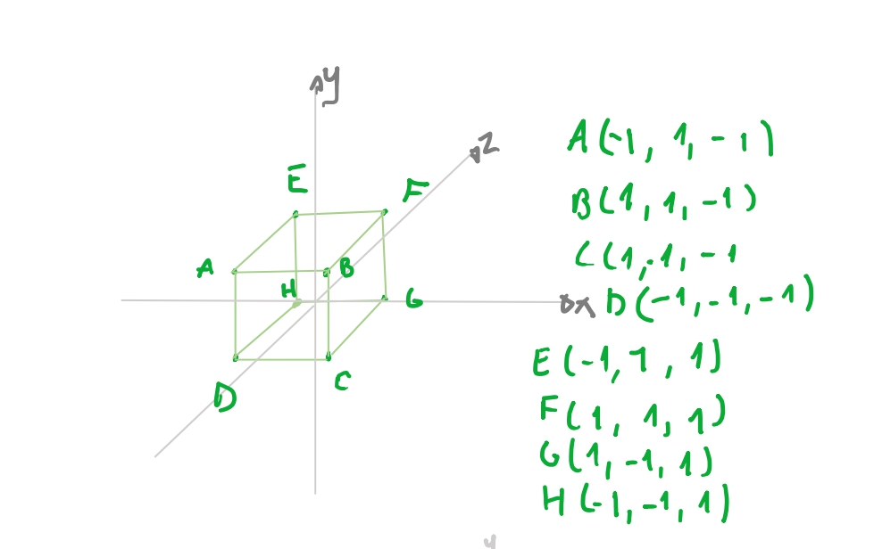

Se decompormos nossas figuras em triângulos precisamos apenas saber quais sao os pontos e como ligar os pontos. No nosso cubo teríamos na face $$ABCD$$ os triângulos: $$ABD$$ e $$BCD$$. Podemos então fazer a seguinte ideia:

```
triangulo:
  | tupla( vertice1, vertice2, vertice3)

modelo:
  | vertices: lista ( tupla (x, y, z))
  | faces: lista( triangulo  )
```

E então para desenhar qualquer figura descrita dessa forma teríamos :

```
função desenha_objeto(objeto)
  para cada triangulo em faces(objeto):
    desenha_triangulo(triangulo)

função desenha_triangulo(triangulo):
  // linha p1-p2
  desenhe_linha(
    projeção->tela(
      mundo->projeção(vértice1)
    ),
    projeção->tela(
      mundo->projeção(vértice2)
    ),
  )

  // linha p2-p3
  desenhe_linha(
    projeção->tela(
      mundo->projeção(vértice2)
    ),
    projeção->tela(
      mundo->projeção(vértice3)
    ),
  )

  // linha p3-p1
  desenhe_linha(
    projeção->tela(
      mundo->projeção(vértice3)
    ),
    projeção->tela(
      mundo->projeção(vértice1)
    ),
  )
```


O cubo foi definido seus vértices em relação a origem. Vamos chamar esse eixo $$x y z$$ de o espaço do cubo. Nesse espaço tem apenas todos os vértices do cubo.
Agora imagine que temos o eixo $$x y z $$ da nossa cena. E nela imagine que temos um cubo a uma distancia de $$4$$ unidades da nossa câmera, no eixo $$z$$.

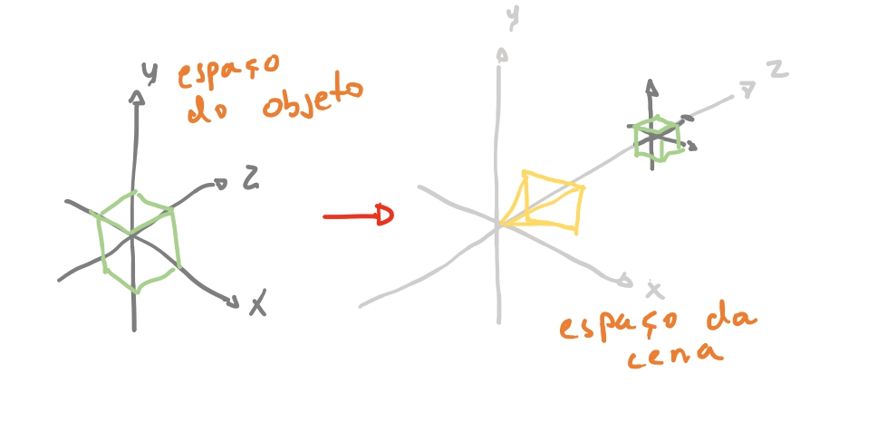

Dizemos que este espaço é o espaço da cena. Mas como vamos levar as coordenadas do nosso cubo para as coordenadas do mundo? 🤔
Se a nossa câmera está na origem $$(0,0,0)$$, o nosso cubo está em $$(0,0,4)$$. Então no nosso espaço da cena só precisamos levar os vértices do nosso cubo para essa posição. Se nós somarmos todas as coordenadas do nosso cubo $$(-1, 1, -1) + (0, 0, 4) = (-1, 1, 3) ...$$ teremos todos os nossos vértices do cubo movidos para a coordenada do espaço da cena.

Vamos usar essa ideia para iniciar nossa modelagem! Queremos então separar um modelo de objeto de sua instancia. Vamos chamar de instancia o que estiver na nossa cena. E modelo o objeto com seus pontos em seu espaço de objeto. Podemos chegar na seguinte ideia:

```
modelo:
  | vertices: lista( tupla(x, y, z) )
  | faces: lista ( tupla(A,B,C) )

instancia:
  | modelo: modelo
  | posicao_cena: (x, y, z)

cubo_em_cena -> instancia:
  | modelo: cubo
  | posicao_cena: (0, 0, 4)
```

Então nessa nossa descrição atual o que faríamos seria a nossa `instancia`, teria uma `posicao_cena = (0, 0, 4)` que somaria em todos os vértices do `modelo` do cubo a posição em cena. Dessa forma conseguimos ter quantas instancias de cubos quisermos e na posição que quisermos.

Mas... 🤔 como podemos girar, escalar? Vamos precisar de transformações.

# Entendendo transformações

Esta parte do texto é onde eu vou explicar como vamos fazer para transformar a posição dos objetos em cena. Vai ser uma introdução alguns conceitos matemáticos de uma area chamada "álgebra linear". Se quiser, pode só pular este capitulo e seguir para o próximo, onde vamos apenas usar essas estruturas 🤷. Apesar de poder ignorar e só usar "como funciona" é possível mas vai ser difícil de entender como tudo funciona.

Vamos começar explicando como as transformações em 2D funcionam. Assim que entendemos elas, vamos aumentar para três dimensões!

Um conceito inicial são vetores. Vetores em duas dimensões são as coordenadas $$(x, y)$$ de um ponto no plano. O ponto $$(2, 2)$$ é o vetor $$\vec{v} = (2, 2)$$ em que sua $$x$$-coordenada$$=2$$ e sua $$y$$-coordenada$$=2$$.
A soma e a subtração de vetores é a soma de suas coordenadas. Então a soma de $$\vec{v} + (1,2) = (3, 4)$$.
Multiplicar um vetor por um numero é multiplicar as componentes vetor $$\vec{v} = (2, 2)\cdot3 = (6,6)$$. Chamamos o numero multiplicado de `escalar`. E realmente passa a ideai de "esticar" o vetor em uma multiplicação por um valor $$>1 $$ e de "encolher" caso multiplicamos por $$ < 1$$.
Multiplicar dois vetores é um pouco mais complicado. Então vamos abordar no futuro.

Então temos cada vértice o nosso cubo é dado por um vetor. Queremos então encontrar uma forma de rotacionar os pontos do cubo (nossos vetores), esticá-los e, por fim, move-los.

Vamos começar com  "estica-los". Como vimos acima, para "escalar" um vetor, basta multiplicar pelo valor de escala. Poderíamos então com a nossa instancia, "multiplicar" todos os vértices por um valor de escala. E para mover bastaria somar com o vetor de posição do nosso cubo. O problema começa a aparecer ai. Seriam muitas contas que teríamos que deixar explicitas e nosso código começaria a ficar muito complexo e difícil de acompanhar.
E se pudéssemos fazer algo como: se temos um vértice $$V$$ $$V' = T_{ranslacao} \cdot R_{otacao} \cdot E_{scala} \cdot V$$ e $$V'$$ seria o vetor que queríamos? Poderíamos usar as mesmas operações em todos os vértices!

#### everything is a matrix neo

Então finalmente chegamos na citação do Morpheus no filme Matrix. Felizmente, existem essas ferramentas na matemática : matrizes.
OBS: [Aqui temos um link](https://matematicabasica.net/matrizes/) para caso você não seja familiar com o básico das operações em matrizes ou precise revisar!

Podemos representar um vetor bidimensional como uma matriz $$2 \times 1$$, ou seja, nosso vetor $$\vec{v} = \begin{bmatrix} 2 \\ 2 \end{bmatrix}$$. E então se multiplicarmos uma matriz pelo nosso vetor, vamos transformar nosso vetor! Mas lembrando de algumas propriedades básicas de matrizes: se quisermos obter um vetor de volta, ou seja, uma matriz de forma $$2 \times 1$$, teremos que multiplicar por uma matriz $$ 2 \times 2$$.

_Obs: nas imagens desta seção, o vetor às vezes aparece escrito à esquerda da matriz ($$\vec{v} \cdot M$$). Com o vetor em forma de coluna ($$2 \times 1$$), a multiplicação só existe com a matriz à esquerda: $$M \cdot \vec{v}$$. É assim que essas contas devem ser lidas, e é assim que escrevemos no texto._

Então vamos ver como podemos chegar em uma matriz de "escala":

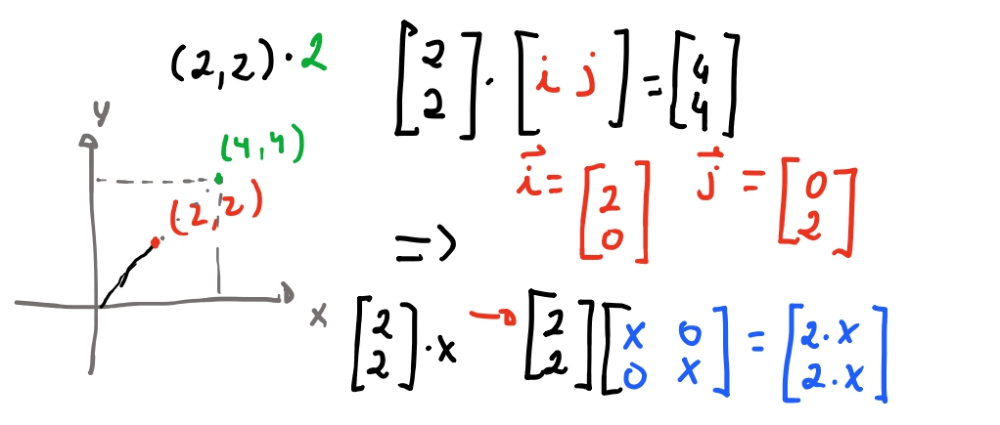

Na imagem acima multiplicamos a matriz $$\begin{bmatrix} i & j \end{bmatrix}$$ pelo nosso vetor $$\begin{bmatrix} 2 \\ 2 \end{bmatrix}$$. O que isso significa 🤔?

Pra entender a imagem acima pensem que os eixos também são vetores:

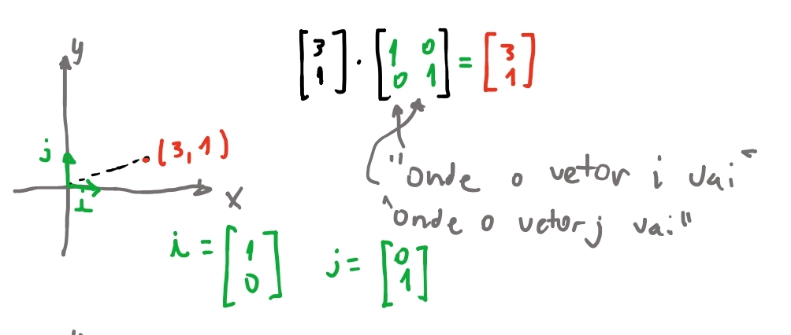

E então os eixos são múltiplos de ambos os vetores $$\vec{i}$$ e $$\vec{j}$$.

Agora vem a magia das matrizes: As transformações nos vetores multiplicados pela matriz vão ser "como $$\vec{i}$$ e $$\vec{j}$$ se transformam".
No exemplo anterior, chegamos em que a matriz para escalar um vetor é $$ \begin{bmatrix} x & 0 \\ 0 & x\end{bmatrix}$$. Em outras palavras é a matriz em que pegamos $$ i = (1, 0) \cdot x$$ e $$j = (0, 1) \cdot x$$ e $$x$$ é o nosso valor de escala! Quando multiplicamos o nosso vetor por essa matriz, nosso vetor escala igualmente os vetores $$\vec{i}$$ e $$\vec{j}$$! 😮‍💨

Com tudo isso dito vamos ver como podemos rotacionar um vetor.

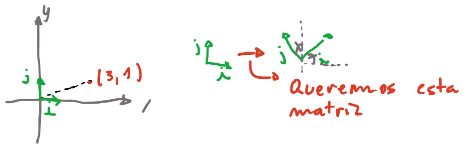

Para rotacionar um vetor $$\vec{v}$$, queremos então rotacionar os vetores $$\vec{i}$$ e $$\vec{j}$$. Como eles são os nossos eixos queremos manter que eles continuem perpendiculares entre si. Então queremos rotacionar os dois a mesma quantia.

Vamos começar pensando como rotacionar o vetor $$\vec{i}$$. E então rotacionaremos o vetor $$\vec{j}$$.
Se quisermos rotacionar $$\vec{i}$$ uma quantia $$\theta$$, podemos usar trigonometria para saber a sua posição. Sabemos que o seu comprimento não muda. E pelas propriedades de trigonometria sua posição em $$y$$ vai ser o $$\sin \theta$$, pois a hipotenusa é o comprimento do nosso vetor (que não mudou de valor $$= 1$$). E o valor em $$x$$ será o $$\cos \theta$$ pela mesma razão.

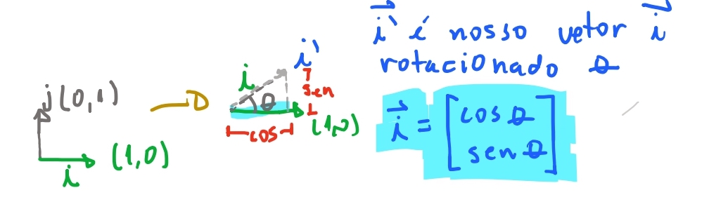

Então o nosso vetor $$\vec{i}$$ dada uma rotação $$\theta$$, irá terminar em $$(\cos \theta, \sin \theta)$$. Ou em notação de matriz: $$\begin{bmatrix} \cos \theta  \\ \sin \theta \end{bmatrix}$$.

Para rotacionar o vetor $$j$$ temos que usar um pouquinho mais de geometria, pois $$\theta$$ é o ângulo entre $$i$$ e $$i'$$. Queremos então o ângulo $$\alpha$$ que o vetor $$j'$$ (o $$j$$ depois da rotação) forma com o eixo horizontal, do lado negativo de $$x$$. Como $$i'$$ e $$j'$$ continuam perpendiculares, sabemos que $$\alpha + \theta = \frac{\pi}{2} = 90º$$. Pelas mesmas propriedades trigonométricas que vimos para o vetor $$i$$, temos $$ j' = (-\cos \alpha, \sin \alpha)$$. Mas queremos esse vetor em função do ângulo $$\theta$$. Como $$\alpha = \frac{\pi}{2} - \theta $$, e o seno de um ângulo é igual ao cosseno do seu complementar, temos $$\cos \alpha = \sin \theta$$ e $$\sin \alpha = \cos \theta$$. Por fim, então, temos $$\begin{bmatrix} -\sin \theta \\ \cos \theta \end{bmatrix} $$ como a coluna para o vetor $$j$$.

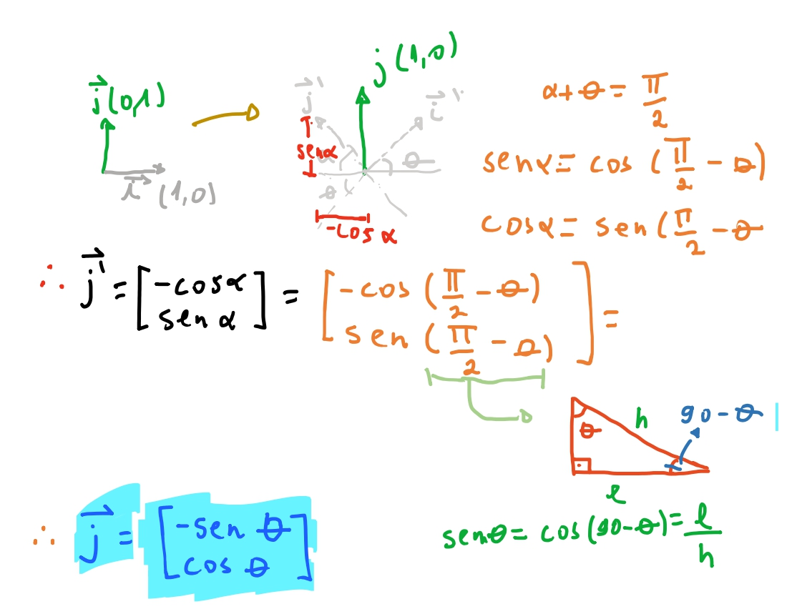

_Obs: na imagem acima, o $$j$$ original é $$(0, 1)$$, e não $$(1, 0)$$. E as identidades corretas são as do texto: $$\cos \alpha = \sin \theta$$ e $$\sin \alpha = \cos \theta$$._

Com isso temos finalmente a matriz de rotação bidimensional : $$\begin{bmatrix} \cos \theta & -\sin \theta \\ \sin \theta & \cos \theta \end{bmatrix}$$.

Vamos ver se conseguimos rotacionar um vetor $$(3,1)$$ $$30º$$ em relação ao eixo horizontal.

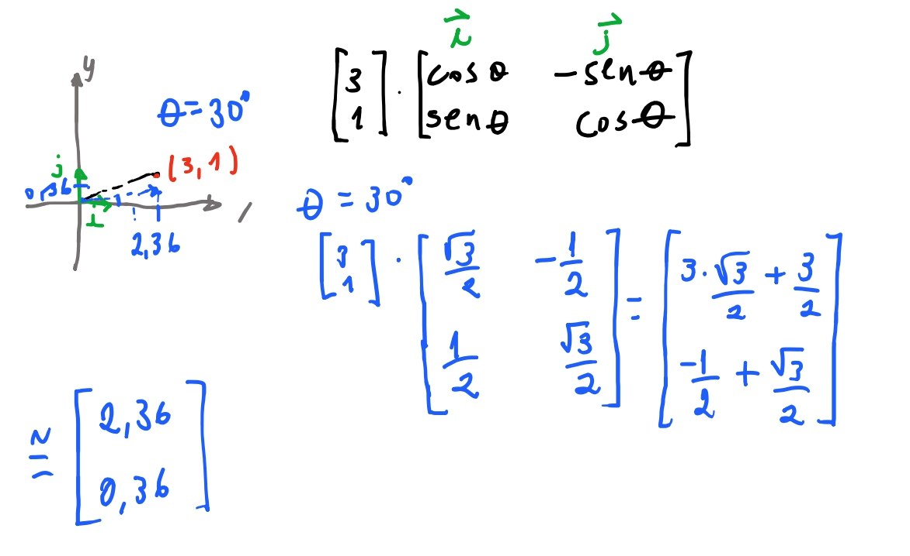

_Correção: a conta da imagem acima tem um erro. O resultado correto é_

$$
R \cdot \begin{bmatrix} 3 \\ 1 \end{bmatrix} = \begin{bmatrix} 3\cos 30º - \sin 30º \\ 3\sin 30º + \cos 30º \end{bmatrix} = \begin{bmatrix} \frac{3\sqrt{3}}{2} - \frac{1}{2} \\ \frac{3}{2} + \frac{\sqrt{3}}{2} \end{bmatrix} \approx \begin{bmatrix} 2.10 \\ 2.37 \end{bmatrix}
$$

_Um jeito rápido de conferir: rotação não muda o comprimento do vetor, e de fato $$\sqrt{2.10^2 + 2.37^2} \approx 3.16 = \sqrt{10}$$, que é o comprimento de $$(3, 1)$$._

Por fim vamos ver como podemos chegar em uma matriz para mover um vetor. É só pensar que queremos uma matriz $$\begin{bmatrix}A & B \\ C & D \end{bmatrix}$$ que, quando multiplicada por um vetor $$\vec{v} = (x, y)$$, some a ele uma quantia $$(T_x, T_y)$$, ou seja, resulte em $$(x+T_x, y+T_y)$$. Então se fizermos esse produto, vamos chegar em um sistema de equações. Vamos ver como uma dessas equações do sistema vai ficar: $$Ax + By = T_x + x$$. Como precisamos de $$x$$, logo $$A$$ pode ser $$1$$, portanto $$By = T_x$$.

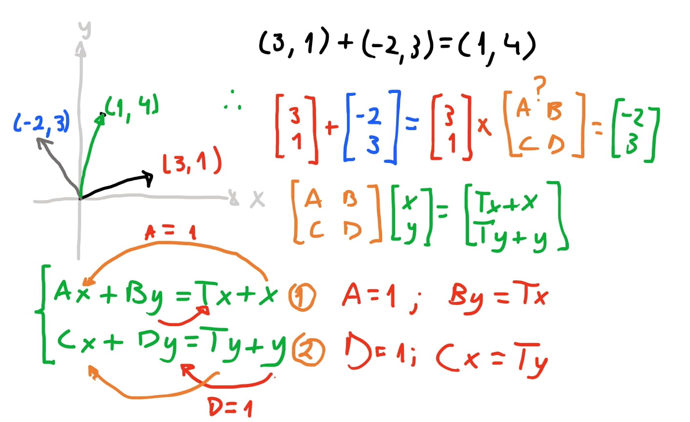

_Obs: na imagem acima, o resultado da soma $$(3,1) + (-2,3)$$ é $$(1, 4)$$: é esse vetor que deveria aparecer do lado direito da primeira linha._

Então disso temos que o valor $$B = \frac{T_x}{y}$$. E similarmente, temos que $$C = \frac{T_y}{x}$$. Então nossa matriz de translado é $$ = \begin{bmatrix} 1 & \frac{T_x}{y} \\ \frac{T_y}{x} & 1 \end{bmatrix}$$.
Repare em uma coisa estranha: os termos $$B$$ e $$C$$ dependem do $$x$$ e do $$y$$ do próprio vetor. Guarde isso, vai ser importante daqui a pouco.

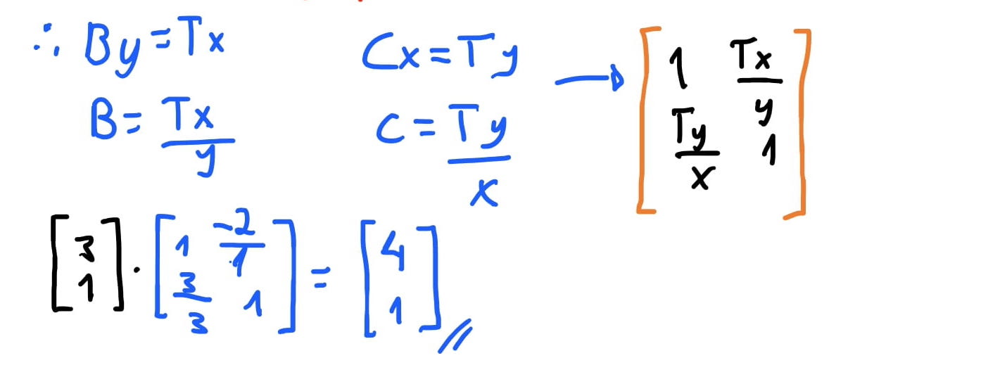

_Obs: na verificação da imagem acima, o resultado correto é $$\begin{bmatrix} 1 & -2 \\ 1 & 1 \end{bmatrix} \cdot \begin{bmatrix} 3 \\ 1 \end{bmatrix} = \begin{bmatrix} 1 \\ 4 \end{bmatrix}$$, que é o $$(3,1)$$ transladado por $$(-2, 3)$$._

Então finalmente temos que as nossas matrizes de transformação para vetores bidimensionais são as seguintes:

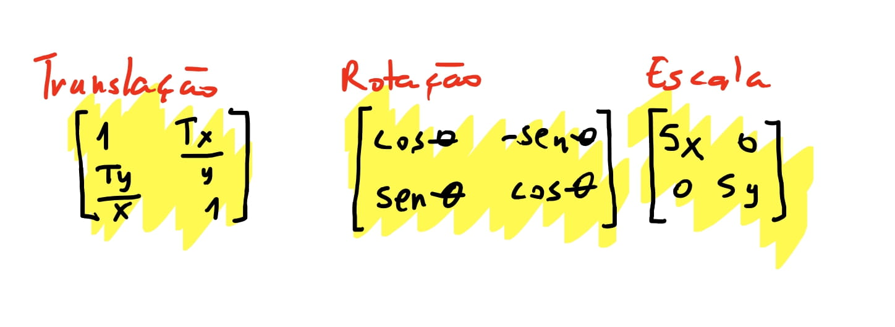

😮‍💨 Depois de tanta coisa temos que pensar "sera que a ordem dessas transformações importa"? E a resposta é: sim!
Veja, se rotacionamos um quadrado na origem, e depois o movemos é diferente de movermos um quadrado e depois rotacionamos:

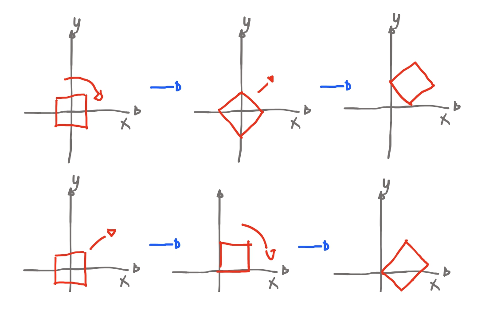

Então pensando que vamos girar algo sempre em relação à origem, portanto é melhor começarmos escalando ja que não altera os pontos, apenas "os estica". Depois podemos então rotacionar e por fim, mover. Se sempre usarmos essa ordem, sempre as transformações serão como a gente espera : `escalar -> rotacao  -> mover`.

Com tudo isso dito esta na hora de voltarmos para as três dimensões!

## Estendendo para três dimensões

Então temos o nosso cubo no espaço do objeto. Temos a sua instancia que agora possui uma propriedade que nos diz sua `rotação`, `escala` e `posição` na `instancia` desse cubo no espaço de cena. Então relembrando o que queremos fazer é: pegar os vértices do nosso cubo, leva-los para o espaço de cena, projetar os vértices em cena no plano da câmera e por fim com os pontos da câmera, conectar os pontos como triângulos e desenha-los na tela. E agora temos matrizes para representar todas essas transformações da seguinte forma: para um vértice $$V$$ do cubo, o ponto $$P'$$ projetado vai ser: $$P'= P_{rojeção} \cdot T_{ransladar} \cdot R_{otacionar} \cdot E_{scalar} \cdot V $$. Sendo que a matriz de $$P_{rojeção}$$ a matriz que leva o ponto da cena para o espaço de projeção! E obter a nossa matriz de projeção é bem fácil depois de entendermos como funciona para projetar um ponto como vimos no post anterior.

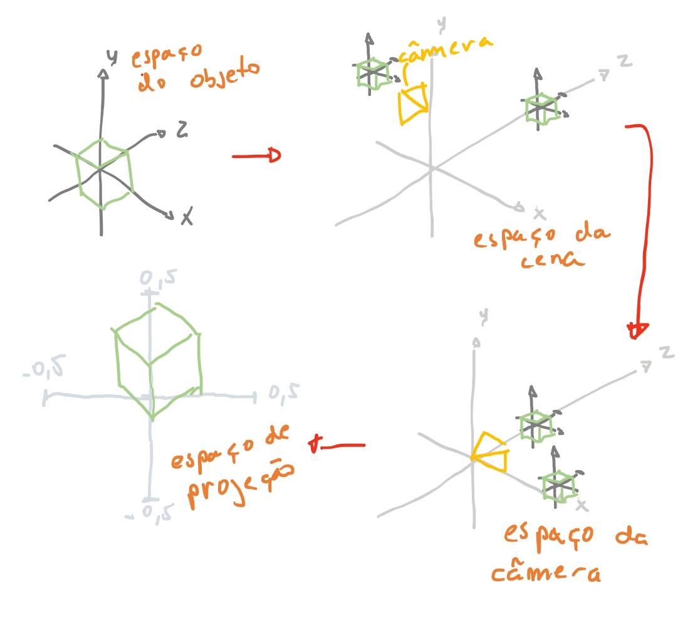

## um problema emerge 😨

O problema é que se tentarmos usar a matriz de translação como fizemos vai acontecer um erro!
Vejamos:

Vamos testar nossas matrizes multiplicando juntas. Vamos testar rotacionar um vetor e transladar ele. Temos o vetor $$(2,2)$$ e queremos rotacionar por $$\frac{\pi}{4} = 45º$$ e depois transladá-lo por $$(1, 3)$$. Ele deveria então ir para a posição $$(1, 3 + 2\sqrt{2}) \approx (1, 5.83)$$. Mas usando nossas matrizes ele não vai pro lugar certo! 😫

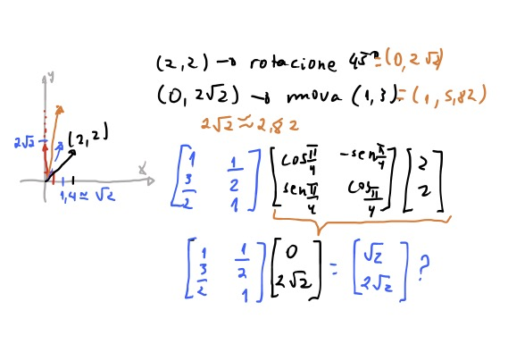

E ele não funcionou porque a matriz de translação que chegamos, só consegue transladar o vetor em que ela foi construída. No caso, a matriz $$\begin{bmatrix} 1 & \frac{1}{2} \\ \frac{3}{2} & 1 \end{bmatrix}$$ só consegue transladar corretamente o vetor $$(2, 2)$$. Mas se multiplicarmos essa matriz por qualquer outro vetor, ela não mais vai fazer o que nós esperávamos. Então não vamos conseguir usar essa matriz de translado multiplicando as transformações.

O motivo de fundo é que translação **não é uma transformação linear**. Qualquer matriz multiplicada pelo vetor $$(0, 0)$$ dá $$(0, 0)$$: nenhuma matriz $$2 \times 2$$ consegue tirar a origem do lugar. A nossa "matriz de translado" só funcionava porque usava o $$x$$ e o $$y$$ do próprio vetor, e por isso ela nem existe quando $$x$$ ou $$y$$ valem zero (divisão por zero). Repare que o $$(2,2)$$ girado $$45º$$ é justamente $$(0, 2\sqrt{2})$$, com $$x = 0$$: para ele, $$C = \frac{T_y}{x}$$ nem pode ser calculado. 🤔 E agora?

## coordenadas homogêneas !

Um pequeno truque vai permitir que nós possamos fazer a nossa matriz de translado conseguir multiplicar o translado a todas as outras transformações: e esse truque chama coordenadas homogêneas. A ideia é colocar mais uma coluna em todas as transformações e usar o nosso vetor de duas dimensões com $$(z = 1)$$, ou seja, $$(2, 2, 1)$$.

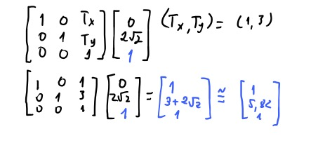

Dessa forma, se estendermos todas as transformações, poderemos multiplicar as transformações como pensamos!
Agora finalmente podemos estender nosso exemplo bidimensional para a terceira dimensão! E da mesma forma vamos usar coordenadas homogêneas nas transformações tridimensionais. Então um vetor tridimensional $$(x,y,z)$$ vamos usar $$(x,y,z,1)$$ !

Estendendo a nossa matriz de translação de duas dimensões para três dimensões é apenas somar a $$z$$ coordenada e colocar mais uma coluna:

$$
T_{ranslação} = \begin{bmatrix}
1 & 0 & 0 & T_x \\
0 & 1 & 0 & T_y \\
0 & 0 & 1 & T_z \\
0 & 0 & 0 & 1
\end{bmatrix}
$$

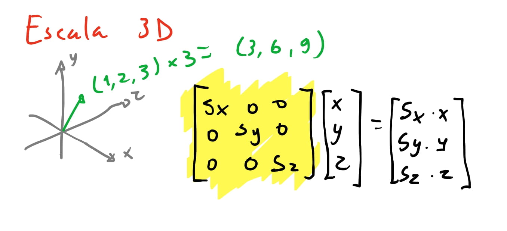

Então temos a nossa matriz de escala para três dimensões! A única coisa que precisamos fazer foi escalar também o eixo $$z$$. Porém esta é a forma da nossa matriz em coordenadas cartesianas. A nossa matriz de escala para coordenadas homogêneas será:

$$
E_{scala} = \begin{bmatrix}
S_x & 0 & 0 & 0 \\
0 & S_y & 0 & 0 \\
0 & 0 & S_z & 0 \\
0 & 0 & 0 & 1
\end{bmatrix}
$$

E por fim chegamos nas matrizes de rotação tridimensional. Como vimos a nossa matriz de rotação bidimensional gira dois eixos e os mantém perpendiculares. A ideia para rotação tridimensional vai ser a mesma, e portanto nos vamos ter três formas de girar: Ao redor do eixo $$x$$, ao redor de $$y$$ e ao redor de $$z$$. Em outras palavras: vamos girar apenas dois eixos e o outro se mantém o mesmo!

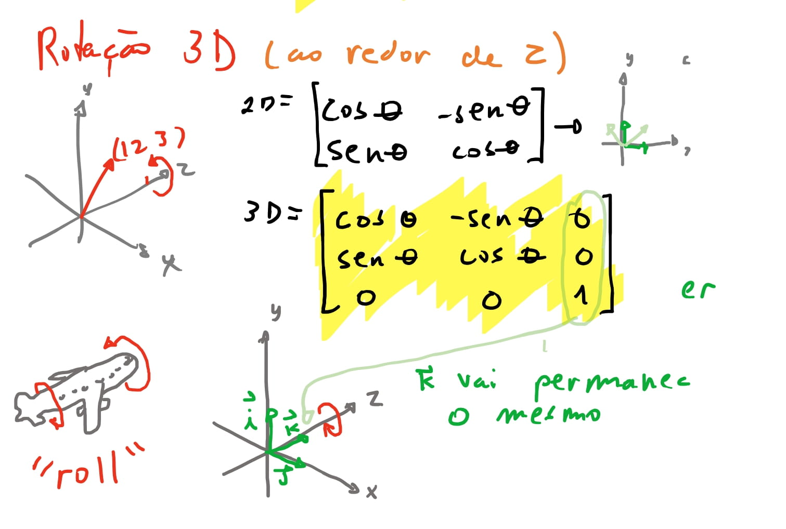

Ao redor do eixo $$z$$ o vetor $$\vec{k}$$ se mantém inalterado $$(0, 0, 1)$$ enquanto os outros dois giram. E agora que temos nossa matriz, vamos igual as matrizes de escala e rotação transformar em coordenadas homogêneas:

$$
R_{otação}^{z} = \begin{bmatrix}
\cos \theta & -\sin \theta & 0 & 0 \\
\sin \theta & \cos \theta & 0 & 0 \\
0 & 0 & 1 & 0 \\
0 & 0 & 0 & 1
\end{bmatrix}
$$

A rotação ao redor de $$x$$, o eixo $$i$$ permanece $$(1, 0, 0)$$

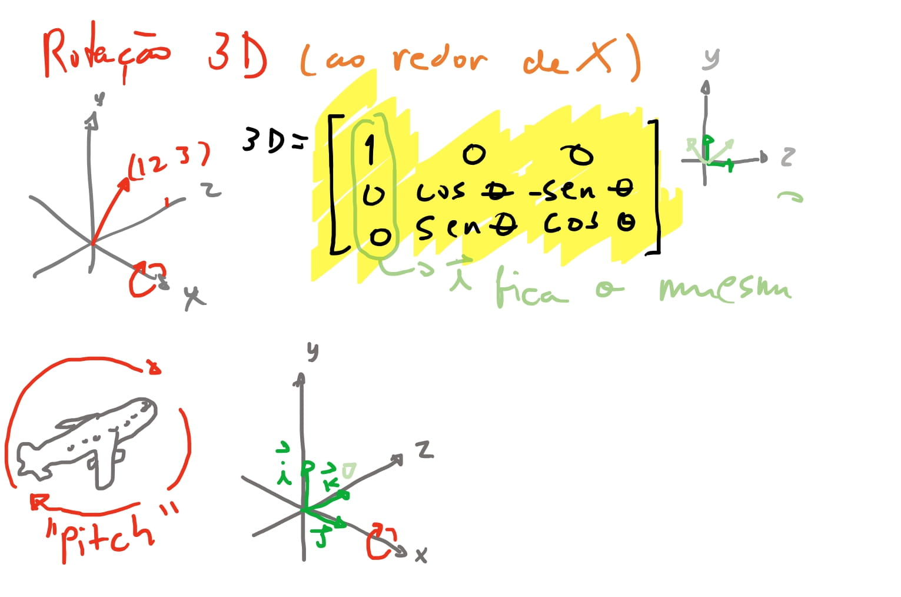

E a nossa matriz em coordenadas homogêneas seria:

$$
R_{otação}^{x} = \begin{bmatrix}
1 & 0 & 0 & 0 \\
0 & \cos \theta & -\sin \theta & 0 \\
0 & \sin \theta & \cos \theta & 0 \\
0 & 0 & 0 & 1
\end{bmatrix}
$$

E por fim a rotação ao redor do eixo $$y$$.

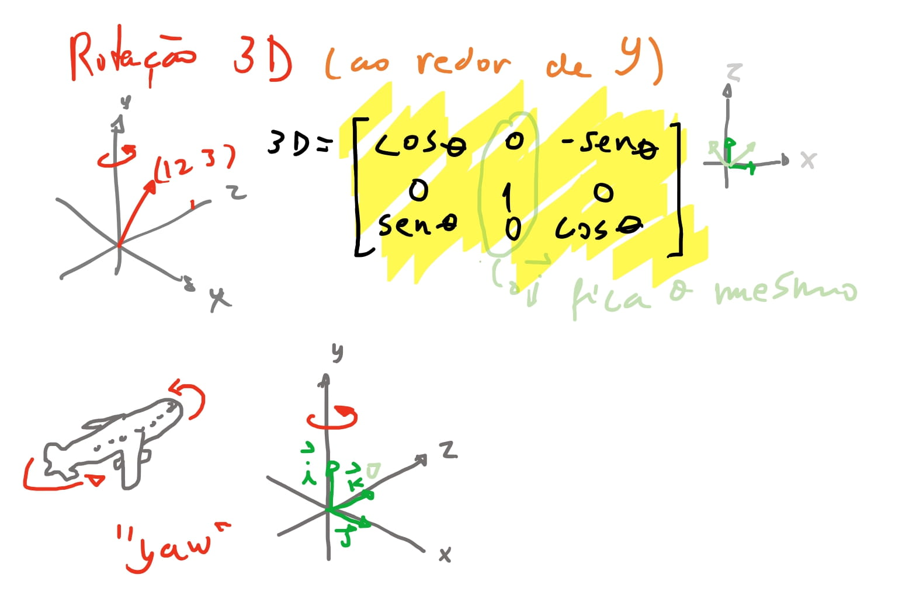

_Obs: na imagem acima, os sinais dos senos estão trocados (aquela matriz gira por $$-\theta$$). A matriz correta, que gira no mesmo sentido que $$R^{x}$$ e $$R^{z}$$, é a de baixo. Nos mini-diagramas das três últimas imagens, os rótulos $$i$$ e $$j$$ dos eixos também aparecem trocados: $$i$$ é o eixo $$x$$ e $$j$$ é o eixo $$y$$._

E por fim estendendo nossa matriz para as coordenadas homogêneas temos:

$$
R_{otação}^{y} = \begin{bmatrix}
\cos \theta & 0 & \sin \theta  & 0 \\
0           & 1 & 0 & 0 \\
-\sin \theta & 0 & \cos \theta & 0 \\
0           & 0 & 0 & 1
\end{bmatrix}
$$

# matriz de projeção!

Estamos quase la! Na verdade, se a câmera não se mover, ja conseguimos mover o ponto e os vértices livremente pela cena usando nossas matrizes. Mas agora que ja fomos tão longe queremos chegar na nossa matriz de $$P_{rojeção}$$ como citamos acima para justificar todo esse exercício com matrizes.
Como vimos, para projetar um ponto $$(x, y, z)$$ mapeamos ele para nossa tela de projeção da câmera $$(\frac{x\cdot d}{z}, \frac{y\cdot d}{z}, d)$$.
Podemos então fazer uma matriz que faça essa transformação!

Vamos usar então uma propriedade das coordenadas homogêneas que começamos a usar! Usamos coordenadas homogêneas até agora para conseguirmos uma matriz de translação que pode ser multiplicada com as outras transformações. Mas o uso das coordenadas homogêneas vai além! A começar em como podemos saber se estamos falando de um ponto ou de um vetor? Apesar de um vetor poder representar um ponto no espaço, podemos querer saber de algum ponto específico. Então para conseguirmos diferenciar entre um vetor e um ponto, dado nossa coordenada homogênea $$(x, y, z, w)$$, se $$w = 1$$ representa um ponto. E se $$w = 0$$ representa um vetor. Então $$\vec{v} = (1, 2, 3, 0)$$ é um vetor enquanto $$P = (1, 2, 3, 1)$$ é um ponto.

Então a propriedade das coordenadas homogeneas é essa representação mista de pontos e vetores. Podemos representar a soma de dois vetores e vai resultar em um vetor: $$(0, 0, 1, 0) + (1, 1, 1, 0)  = (1, 1, 2, 0)$$, multiplicar um vetor por um escalar $$(1, 1, 1, 0) \cdot 2 = (2, 2, 2, 0)$$ e vamos ter um vetor, e se subtrairmos dois pontos vamos obter um vetor $$(3,2,1,1) - (1, 1,1,1) = (2, 1, 0, 0)$$.
Qualquer valor de $$w \neq 0$$ é só outra representação do mesmo ponto. Existem infinitas representações do mesmo ponto. O ponto $$(1,2,3,1)$$ é igual $$(2,4,6,2)$$ assim como é igual à $$(-4, -8, -12, -4)$$. A representação $$w = 1 $$ é chamado de "representação canônica".
E para transformar uma coordenada homogênea para coordenada cartesiana basta dividir as outras componentes por $$w$$.

$$
(x, y, z, w)  = (\frac{x}{w}, \frac{y}{w}, \frac{z}{w}, \frac{w}{w} = 1) \rightarrow (\frac{x}{w}, \frac{y}{w}, \frac{z}{w})
$$

E como sabemos, para projetar um ponto tridimensional cartesiano no plano da camera temos que chegar na seguinte equação de projeção: $$(x,y,z) \rightarrow (\frac{x\cdot d}{z}, \frac{y \cdot d}{z}, d)$$.
Se fizermos uma matriz que consegue fazer com que $$w = z$$, vamos conseguir chegar em uma transformação que faria nossa coordenada homogênea projetar o ponto pela própria operação: $$(x,y,z,z) \rightarrow (\frac{x}{z}, \frac{y}{z}, \frac{z}{z}, 1)$$, e bastaria multiplicar por $$d$$ que teríamos a nossa equação de projeção.

Então vamos ver como podemos chegar na matriz de projeção.

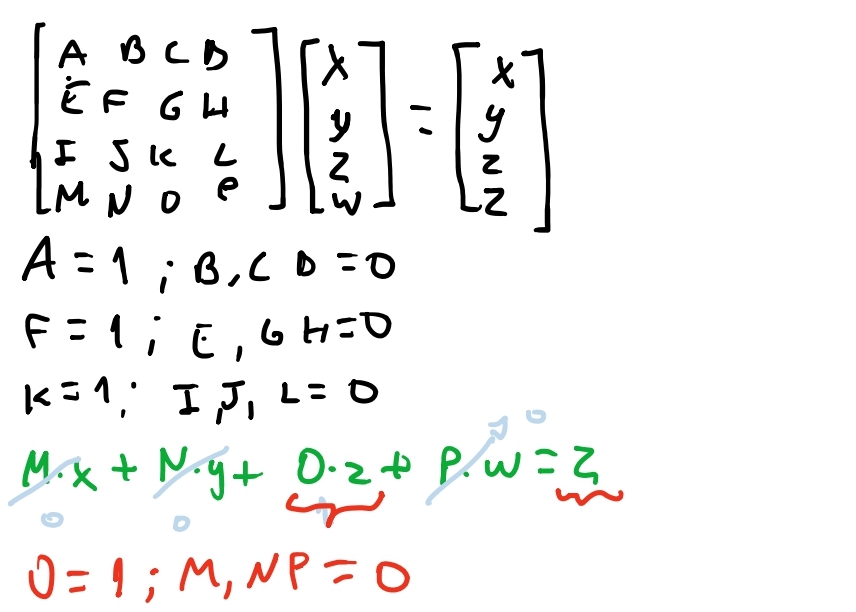

Acima vemos que do nosso sistema de equações, apenas o termo $$O = 1$$ para matriz resultar que o valor de $$w$$ do nosso vetor receba o valor de z.
Com isso temos a matriz:

$$
\begin{bmatrix}
1 & 0 & 0 & 0 \\
0 & 1 & 0 & 0 \\
0 & 0 & 1 & 0 \\
0 & 0 & 1 & 0
\end{bmatrix}
$$

Mas nossa equação de projeção ainda precisa multiplicar pela distancia do plano de projeção $$d$$. Para isso multiplicamos, à esquerda, pela matriz de escala $$\begin{bmatrix} d & 0 & 0 & 0 \\ 0 & d & 0 & 0 \\ 0 & 0 & d & 0 \\ 0 & 0 & 0 & 1 \end{bmatrix}$$ (na imagem a conta aparece como matriz vezes vetor, mas é um produto de duas matrizes $$4 \times 4$$).

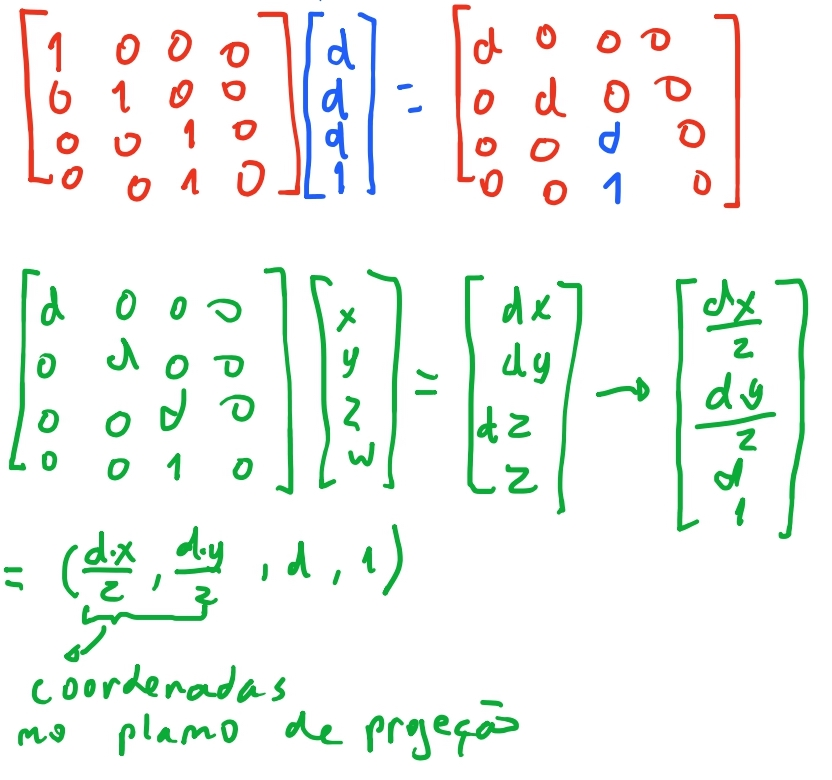

Logo temos que a nossa matriz de projeção é, finalmente:

$$
P_{rojeção} = \begin{bmatrix}
d & 0 & 0 & 0 \\
0 & d & 0 & 0 \\
0 & 0 & d & 0 \\
0 & 0 & 1 & 0
\end{bmatrix}
$$

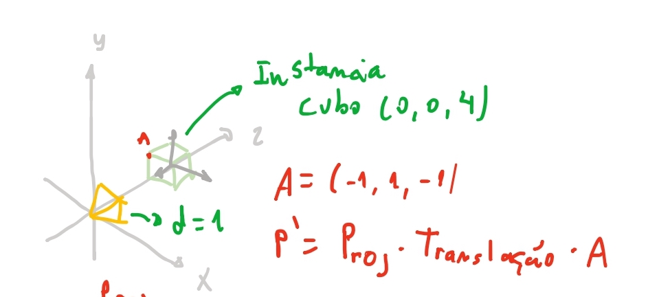

Vamos testar se nossa matriz funcionará com o exemplo do cubo do post anterior usando uma instancia do nosso cubo, onde vamos coloca-lo na posição do mundo $$(0,0,4)$$ e projeta-lo na tela

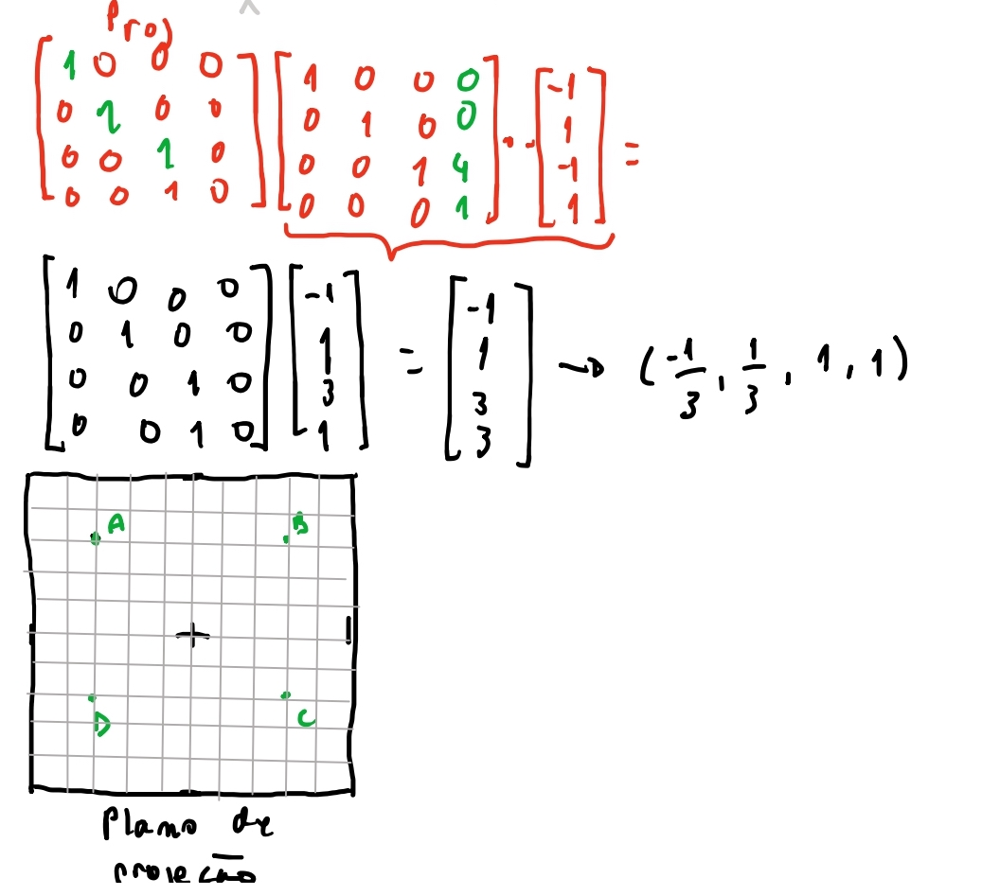

Podemos ver que se projetarmos os quatro pontos $$ABCD$$ teremos projetados corretamente!
E quando convertermos o vetor de coordenadas homogêneas para cartesianas, teremos finalmente o ponto projetado corretamente!

Então vamos ver como isso vai funcionar:

```
cubo_em_cena -> instancia:
  | modelo: cubo
  | transformacoes:
    | translacao: (0, 0, 4)
    | rotacao: (0, 45, 0)   // graus, em torno de x, y e z
    | escala: (0.5, 0.5, 0.5)

câmera:
  | posição : (0, 0, 0)
  | plano_proj: 1

função desenha_cena(objetos_em_cena):
  para cada instancia em objetos_em_cena:
    desenha_objeto(instancia)

função desenha_objeto(instancia):
  matriz_translado = Matriz4x4(instancia.transformacoes.translacao)
  matriz_rotacao = Matriz4x4(instancia.transformacoes.rotacao)
  matriz_escala = Matriz4x4(instancia.transformacoes.escala)

  seja pontos_projetados = []
  para cada vertice em instancia.modelo.vertices:
    vertice_homogeneo = Vetor4f(vertice.x, vertice.y, vertice.z, 1)

    // Vetor2f converte para cartesiano: divide x e y por w
    pontos_projetados.insere(
      Vetor2f(matriz_projeção * matriz_translado * matriz_rotacao * matriz_escala * vertice_homogeneo)
    )

  para cada triangulo em instancia.modelo.faces:
    desenha_triangulo(triangulo, pontos_projetados)


// agora utilizaremos triangulo como o indice das faces como citamos no começo do texto
função desenha_triangulo(triangulo, pontos):
  //p1->p2
  desenha_linha(
    pontos[triangulo[0]], pontos[triangulo[1]]
  )
  //p2->p3
  desenha_linha(
    pontos[triangulo[1]], pontos[triangulo[2]]
  )
  //p3->p1
  desenha_linha(
    pontos[triangulo[2]], pontos[triangulo[0]]
  )
```

E com isso ja conseguimos desenhar na tela nosso cubo !

O cubo nós renderizamos na mesma posição em que estava na cena anterior, porem, rotacionamos em relação ao eixo $$y$$ em $$45º$$ e escalamos $$0.5$$ em todos os eixos!

Segue a nossa implementação em que comentamos como funciona nossas matrizes:



O código acima roda em tempo real: edite à vontade e veja o resultado mudar!

Ficou faltando uma coisa que listamos lá no começo: mover a câmera. Por enquanto ela continua fixa na origem, olhando para $$+z$$. Mover a câmera é o mesmo que aplicar em todos os objetos da cena a transformação *inversa* da câmera (se a câmera anda para a direita, o mundo anda para a esquerda), e isso fica para um próximo texto.

## Referências

- Gabriel Gambetta, [*Computer Graphics from Scratch: A Programmer's Introduction to 3D Rendering*](https://gabrielgambetta.com/computer-graphics-from-scratch/), No Starch Press, 2021. A sequência desta série segue de perto a parte de rasterização desse livro, que pode ser lido de graça online.
- James D. Foley, Andries van Dam, Steven K. Feiner e John F. Hughes, *Computer Graphics: Principles and Practice*, Addison-Wesley. O livro clássico da área, para quem quiser se aprofundar em cada um dos tópicos da série.


