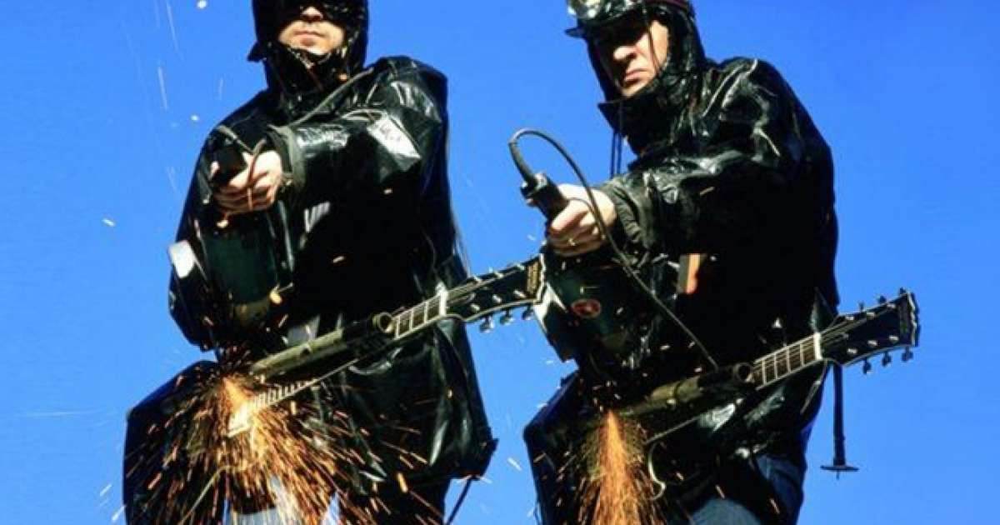

Em 1994, Bill Drummond e Jimmy Cauty, a dupla que tinha formado a banda KLF, queimaram 1 milhão de libras em um galpão na ilha de Jura, na Escócia. No ano seguinte, viajaram pela Inglaterra exibindo o filme da queima em sessões abertas de cinema. Naquela época 1 milhão de libras simbolizava a fuga da "vida cotidiana" de lutar pelo ganha pão, simbolizava a entrada em uma classe social em que não mais precisava "ganhar o pao de cada dia", mas que o dinheiro podia render e, portanto, viver de renda. Era um valor simbólico que a banda havia queimado. O cinegrafista e amigo da dupla, não entendia muito bem o porque eles estavam fazendo e, os próprios membros alegaram que, durante o ato, nem eles também sabiam porque estavam fazendo.

Nos anos 80 a musica havia se tornado uma industria, e segundo Drummond and Cauty, a alma da musica havia sido vendida pelo mesmo peso em ouro. Então, no começo da era digital e nos primórdios dos sons sintetizados em computador, os dois tiveram uma brilhante ideia: E se fizessem uma musica pop em que não pudesse ser comercializada? Em 1987 fizeram uma musica chamada _The Queen and I_, que criticava a democracia Inglesa e usava samples de uma musica do ABBA. A musica ganhou popularidade e com a mesma velocidade em que ganhou o publico recebeu igualmente em processos. Era genial. Na época ainda se chamavam the Jams. Acontece que a historia da vitoria da dupla Drummond e Cauty sobre o capitalismo musical virou contra eles.

KLF inovando com mais musicas digitais e iniciando gêneros musicais, ainda com a veia punk de rebelar contra a industria musical, começaram a fazer sucesso e o próprio sucesso deles era o que os levaria a queimar os 1 milhão de libras. No meio do sucesso, eles perceberam que a industria havia se adaptado, e agora os samples, que antes geravam processos, agora eram vastamente usados. A industria da musica havia se adaptado e Cauty e Drummond eram os responsáveis. No meio da fama e com riqueza e influencia que conquistaram justamente pela mesma industria que queriam destruir, queimaram os 1 milhão de libras, como protesto: Se dessem para alguma ONG, ou para alguém, o dinheiro ainda existiria e ainda continuaria existindo e tendo influencia. E portanto, na visão deles, o único jeito de eles se libertarem era queimando.

Cauty e Drummond tinham desfeito a banda em 1992, antes da queima, mas seguiram suas carreiras artísticas. Ainda como verdadeiros punks. Ao se tornarem milionários, disseram que venderam sua alma para o capitalismo. E queimar, foi a sua forma de recomprar sua alma de volta, e junto dela, sua expressão artística.

A história do KLF beira o que é real e o irreal. E quando não há como definir se algo é real ou não sobra apenas os símbolos do universo que nos cerca e como interagimos com eles depende das varias formas como nós interpretamos eles. Quanto mais melhoramos o nosso rasterizador mais nos aproximamos da dificuldade de discernir o real do irreal. E este texto vai tratar da primeira parte de como vamos "dar realidade" aos objetos. Toda a parte que tratamos até agora apenas lidou com a representação e projeção. Mas o que da o realismo é como "preenchemos" os triângulos em cada um dos nossos objetos. Cada pixel deve receber a cor certa para atingirmos o realismo.

Neste texto vamos construir nosso algoritmo que finalmente vai rasterizar os triângulos que compõe nossa cena. Rasterizar é o ato de preencher os triângulos. Então precisamos elaborar um algoritmo que consiga preencher qualquer triangulo independente da sua orientação. Mas só preencher não será suficiente. Vamos elaborar algum algoritmo para saber a ordem em que desenhamos estes triângulos, pois, depois que projetarmos, há faces que não serão visíveis.

# Como vamos preencher nossos modelos ?

Para preencher nosso modelo precisamos preencher todas as faces com as cores específicas. Neste texto vamos discutir primeiro como podemos preencher as faces dos triângulos. Nos próximos vamos ver como podemos preencher esses triângulos com cores específicas para reproduzirmos efeitos de iluminação e textura. Mas por enquanto, vamos nos conter a preencher as faces.

Então queremos pensar em um algoritmo para preenchera as faces dos triângulos. Depois que conseguirmos ainda vai acontecer um fenômeno: os triângulos vao ser coloridos pela ordem que foram definidos. Então precisamos pensar em alguma forma auxiliar para colorir os triângulos que estão mais próximos da câmera somente.

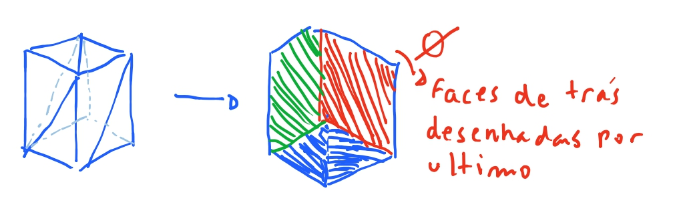

Para preencher triângulos existem vários algoritmos conhecidos. O que vamos usar aqui inicialmente vamos usar a mesma ideia por trás de como desenhamos linhas no nosso primeiro texto. Nós precisamos saber quais são as equações de reta entre os vértices dos triângulos e isso vai permitir nós sabermos quais os pontos estão nas arestas do triangulo. Com essa aresta, se nos iterarmos pela altura do triangulo, para preencher o triangulo vai bastar desenhar uma linha de aresta em aresta para cada valor da altura do triangulo.




E ai vai bastar que a gente consiga controlar qual face vai ser desenhada. Existindo a técnica do pintor: O pintor quando vai produzir seus quadros primeiro desenha o fundo, depois o que ta um pouco a frente do fundo e por fim o que está mais próximo. Podemos usar este algoritmo. O problema é que existem figuras que o algoritmo do pintor ainda não vai conseguir resolver. Então uma melhoria no algoritmo do pintor seria que ao invés de pintar triangulo por triangulo dada a profundidade, pintarmos um pixel por profundidade. Então sempre coloríamos o pixel com a $$z$$-coordenada mais próxima da câmera.

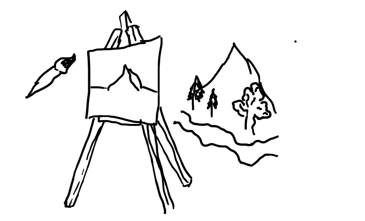

Por fim, há portanto de se pensar que existem inúmeras faces do nosso modelo que nunca seriam vistas, e de toda forma, estariam sendo pintadas com o algorismo do pintor. Então para melhorar a eficiência, poderíamos saber quais sao as faces que vao ser pintadas e remover as que nao serão. Sendo este algoritmo chamado de `face culling`. Ao combinarmos estes algoritmos vamos conseguir visualizar nossos modelos tridimensionais propriamente coloridos!

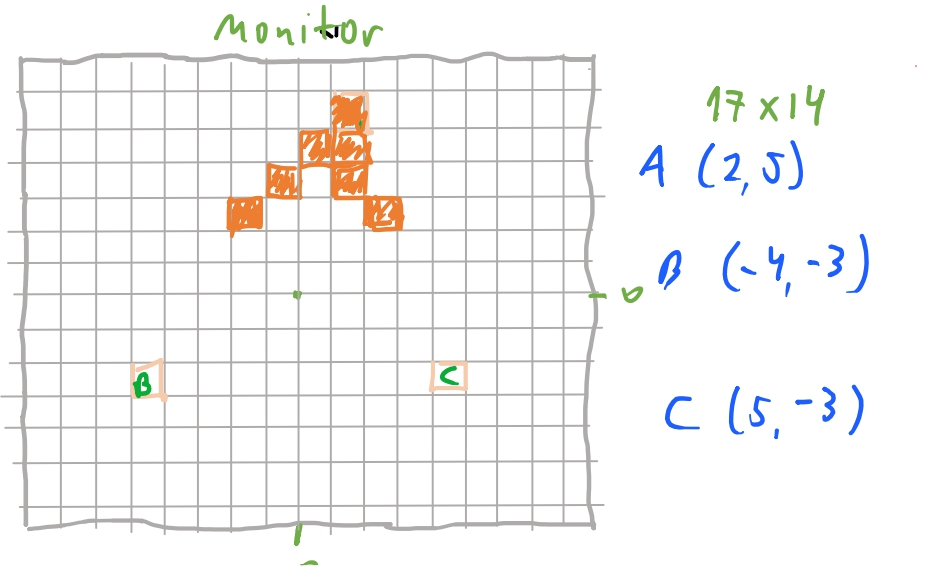

Então vamos pensar em como podemos preencher um triangulo. Uma ideia que temos que fixar ja desde o começo é que nossa tela de pixels é discreta. Isto é: todos os indices dos pixels são valores inteiros. Não existe um pixel $$3.4$$ ou $$1.15$$. Então temos que desde ja pensarmos que qualquer valor racional deve ser convertido para um inteiro.

Então vamos ver como podemos chegar no algoritmo para desenhar nosso triangulo. Vimos acima a ideia por tras. Agora vamos ver como podemos implementa-la. Então imagine que temos um triangulo com os vértices $$A (2, 5)$$ $$B (-4, -3)$$ e $$C (5, -3)$$. _OBS: Apenas para relembrar que no primeiro texto e no texto de projeção, nós centralizamos as coordenadas dos pixels da tela para que pudéssemos mapear a nossa tela de projeção _ .
Como vamos iterar sobre o eixo-$$y$$, queremos saber quais são os valores de $$x$$ para cada valor de $$y$$. E para nossa sorte, assim como vimos no primeiro post, podemos usar equações de reta entre dois pontos para determinar a equação linear que conecta os dois pontos. Quando tivermos esta equação, conseguiremos calcular o valor das arestas do triangulo dado uma $$y$$-coordenada. Vamos ver como isso vai funcionar:

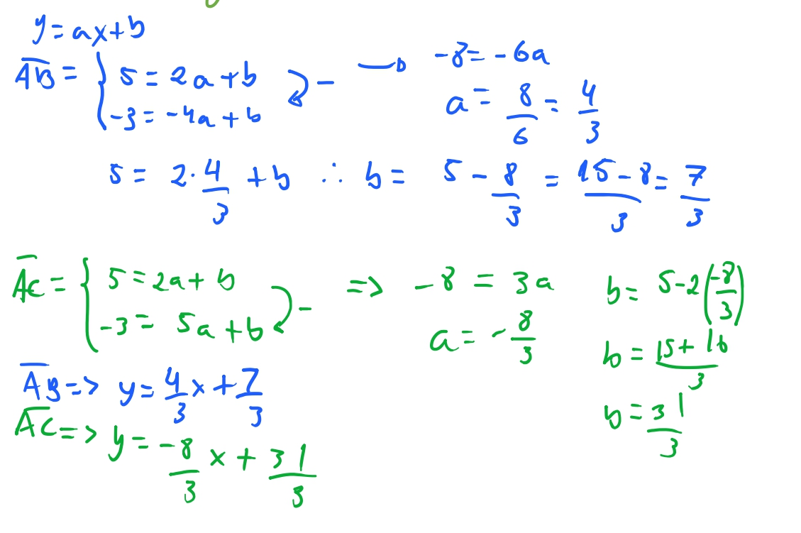

Queremos então iterar sobre o intervalo do maior valor de $$y$$ dos vertices até o menor valor de $$y$$ dos vertices. No nosso exemplo acima, queremos ir de $$5$$ até $$-3$$.  Então temos as nossas retas entre $$\overline{AB} \rightarrow y = \frac{4x}{3} + \frac{7}{3}$$ e temos que a nossa reta $$\overline{AC} \rightarrow y = - \frac{8x}{3} + \frac{31}{3}$$, e  conseguimos calcular alguns valores de $$x$$ para cada valor de $$y$$. E portanto, como podemos ver quando $$y=2$$ temos que $$x= - \frac{1}{4}$$ para a nossa reta $$\overline{AB}$$ e temos que $$x=\frac{25}{8}$$ para a reta $$\overline{AC}$$. A regra que usamos é arredondar para baixo  para o primeiro inteiro. Então temos que $$x = -1$$ para $$\overline{AB}$$ e $$x = 3$$ para $$\overline{AC}$$. Agora basta iterar entre $$-1$$ e $$3$$ e preencher cada pixel. E assim temos a base do nosso algoritmo.

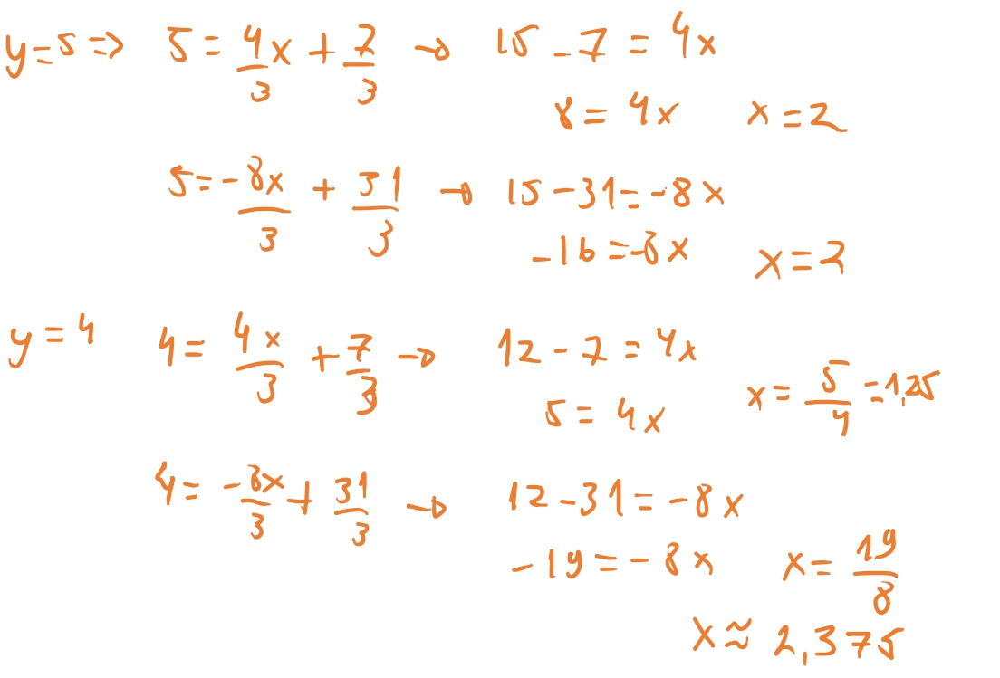

#### casos específicos

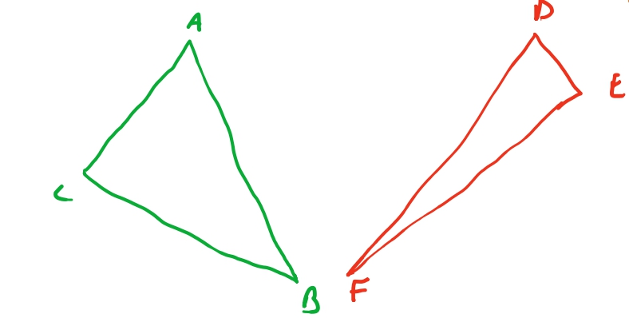

Para iterar de aresta em aresta, vão existir casos como os triângulos acima em que não necessariamente só precisamos usar duas retas, mas as três retas. O triangulo $$ABC$$ possui o lado $$AB$$ mais alto (cobre mais valores de $$y$$) que $$AC$$ e $$BC$$. Então quando formos iterar entre as arestas, algum momento iteraríamos sobre a aresta $$AC$$ até $$AB$$, e depois de $$CB$$ até $$AB$$.
Com isso em mente vamos conseguir agora preencher qualquer triangulo. Então vamos começar a elaborar nosso algoritmo.

Vamos precisar de alguma ferramenta para conseguirmos calcular as nossas equações de reta. Apesar de nos exemplos anteriores nós chegamos em um sistema de equações lineares bem simples para calcular as retas, resolver sistemas lineares para cada triangulo seria bastante complicado. Então vamos ver se conseguimos pensar em alguma ferramenta que possa nos ajudar.

O que precisamos? Queremos alguma forma de para cada $$y$$, encontrar um $$x$$ das arestas do triangulo. Então vamos assumir que temos uma função $$f(y)$$, que para cada $$y$$, retorna um $$x$$ da aresta do triangulo. Então quando a iteração for acontecer, teremos os valores de $$y$$ dos quais estamos iterando, mas precisamos calcular $$x$$. Então $$x$$ é uma variável dependente de $$y$$, e $$y$$, neste caso, é uma variável independente.

### Interpolação linear

Conseguimos então chegar que, haverá uma reta, da aresta do triangulo, que vamos querer encontrar um ponto $$P$$ entre os vértices do triangulo para um dado valor de $$y$$. Esta técnica é conhecida como interpolação linear, e vamos usar bastante essa técnica daqui em diante.

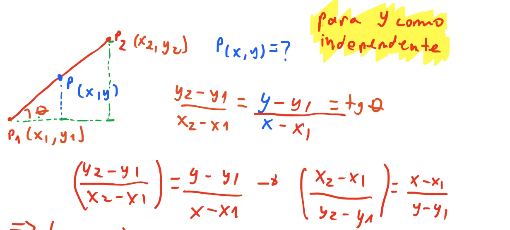
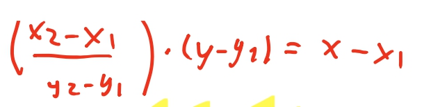
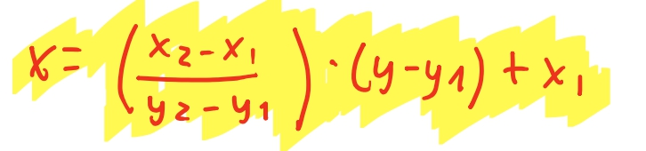

Na imagem acima, podemos visualizar o triangulo formado pelo vertices que queremos calcular a reta. Neste triangulo o lado oposto ao angulo $$\theta$$ é $$y_2 - y_1$$, e o angulo adjacente ao angulo é o lado $$x_2 - x_1$$. A razão do lado oposto pelo adjacente é a tangente do angulo $$\theta$$. Conseguimos perceber que o triangulo formado por $$P_1$$ $$P_2$$ é proporcional ao triangulo formado por $$P_1$$ e o ponto $$P$$ que procuramos. Então conseguimos chegar na seguinte equação:

$$
\frac{y_2 - y_1}{x_2 - x_1} = \tan \theta = \frac{y-y_1}{x-x_1}
$$

Dessa igualdade conseguimos isolar qual vai ser a nossa variável independe e qual vai ser a nossa variável dependente. No nosso algoritmo, vamos ter o valor de $$y$$, mas queremos saber qual o valor de $$x$$. Então, como dissemos acima, $$x$$ vai ser nossa variável dependente. Então vamos resolver essa igualdade para $$x$$.

$$ x = \frac{x_2 - x_1}{y_2 - y_1} \times (y - y_1) + x_1 $$

E podemos enxergar que essa equação realmente é uma equação de reta, da forma $$x = a(y-y_1) + x_1$$, ja que $$x_1$$ é uma constante, e $$a = \frac{x_2 - x_1}{y_2 - y_1} $$ também é.

Vamos testar e ver como essa equação funciona:

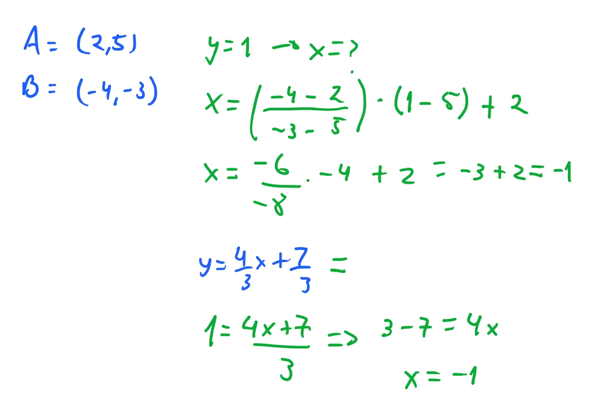

E agora podemos generalizar essa equação, porque não necessariamente só poderíamos esta equação da perspectiva de $$y$$ é independente e $$x$$ é dependente. Poderíamos usar a mesma equação em que os papeis são reversos: em que $$x$$ é independente e $$y$$ é dependente. Então vamos generalizar a equação. Seja $$i$$ a variavel independente e $$d$$ a variavel dependente:

$$
d = \frac{d_2 - d_1}{i_2 - i_1} \cdot (i - i_1) + d_1
$$

Um pseudo algoritmo para nossa função de interpolação linear seria o abaixo. Ela devolve uma lista com um valor de $$d$$ para cada valor inteiro de $$i$$ entre $$i_1$$ e $$i_2$$. Em vez de recalcular a equação inteira a cada passo, aproveitamos que, quando $$i$$ aumenta $$1$$, $$d$$ aumenta exatamente $$a$$:



## Vamos preencher as faces !

Com a nossa função de interpolação linear(também conhecida como `lerp`)em mãos, podemos agora nos concentrar em preencher as faces.
Então vamos esboçar o algoritmo. Para iterar em cada linha que compõe o triangulo, precisamos saber quais sao os vértices com as maiores $$y$$-coordenada. Então vamos ordenar os vértices e com o maior e o menos sabemos quais sao as linhas que vamos iterar.
Com cada linha, vamos usar a função de `lerp` e descobrir quais são as coordenadas de onde começa e termina cada aresta daquela linha. Então vamos iterar entre as arestas e vamos preencher os pixels.

Para lidar com os triângulos que citamos: com os vértices ordenados por $$y$$, a aresta $$\overline{V_1V_3}$$ cobre toda a altura do triângulo, e as outras duas ($$\overline{V_1V_2}$$ e $$\overline{V_2V_3}$$), juntas, cobrem a mesma altura. Então podemos juntá-las e considerar que são apenas um lado. Só precisamos tomar cuidado para não contar duas vezes o $$x$$ de $$V_2$$, que aparece no fim da primeira lista e no começo da segunda. E assim o algoritmo funciona da mesma forma.

E para finalizar, para iterarmos de aresta para aresta, temos que descobrir qual dos dois lados fica à esquerda e qual fica à direita. Para isso basta comparar os dois em uma linha qualquer, por exemplo a do meio: o que tiver o menor $$x$$ está à esquerda. E então iteramos da esquerda para a direita colocando os pixels na dada coordenada.

{% include pseudocode.html id="4" code="
\begin{algorithm}
\caption{PrencherTriangulo}
\begin{algorithmic}
\PROCEDURE{PreencherTriangulo}{$V1, V2, V3$}
  \STATE $V1, V2, V3$ $\leftarrow$ \CALL{Ordenar}{$V1, V2, V3$} por $y$
  \STATE $X_{valores}\overline{V1V2} = $ \CALL{LERP}{$V1.y, V2.y, V1.x, V2.x$}
  \STATE $X_{valores}\overline{V2V3} = $ \CALL{LERP}{$V2.y, V3.y, V2.x, V3.x$}
  \STATE $X_{valores}\overline{V1V3} = $ \CALL{LERP}{$V1.y, V3.y, V1.x, V3.x$}

  \STATE remover o último elemento de $X_{valores}\overline{V1V2}$ \COMMENT{é o mesmo $x$ de $V2$ que abre a próxima lista}
  \STATE $X_{valores}\overline{V1V2V3}$ = $X_{valores}\overline{V1V2}$ seguido de $X_{valores}\overline{V2V3}$
  \STATE meio = \CALL{size}{$X_{valores}\overline{V1V3}$} $ \div 2$

  \IF{$X_{valores}\overline{V1V2V3}[meio] < X_{valores}\overline{V1V3}[meio]$}
    \STATE $x_{esquerda}$ = $X_{valores}\overline{V1V2V3}$
    \STATE $x_{direita}$ = $X_{valores}\overline{V1V3}$
  \ELSE
    \STATE $x_{esquerda}$ = $X_{valores}\overline{V1V3}$
    \STATE $x_{direita}$ = $X_{valores}\overline{V1V2V3}$
  \ENDIF

  \FOR{$y = V1.y$ \TO $V3.y$}
    \STATE $linha = y - V1.y$
    \FOR{$x = x_{esquerda}[linha]$ \TO $x_{direita}[linha]$}
      \STATE \CALL{ponhaPixel}{$x, y$}
    \ENDFOR
  \ENDFOR

\ENDPROCEDURE
\end{algorithmic}
\end{algorithm}
" %}

O que estamos fazendo é portanto, calcular qual a aresta mais à esquerda e mais à direita e iterando sobre ela. Podemos tambem chamar `drawLine(xMaisAEsquerda, y, xMaisADireita,y)` no lugar do segundo `for` no nosso algoritmo. E assim conseguimos preencher qualquer triângulo.


## Faces tridimensionais

Se usarmos este nosso recente algoritmo de preencher triangulos para preencher os triangulos das faces do cubo que chegamos no texto anterior, podemos obter um resultado parecido com esse:



E isso pode se dar pela a ordem em que os triângulos foram desenhados. Os triangulos do fundo do cubo estao sendo desenhados por ultimo, ou casos similares. Mas mesmo descrevendo a ordem "correta", a ordem ia depender do ponto de vista da camera. E se rotacionassemos o cubo novamente veriamos o poligono desenhado incorretamente. Para resolvermos este inconveniente, vamos criar uma ordem de pintura. E a solução é muito simples. Desenhamos o que esta mais longe primeiro, e o que esta mais perto da camera por ultimo. Assim sempre garantimos que a face da frente sempre esteja na frente.

Podemos calcular a profundidade de cada triângulo (por exemplo, a média do $$z$$ dos seus vértices), ordenar os triângulos do mais distante para o mais próximo e desenhá-los nessa ordem. Este algoritmo chama-se [algoritmo do pintor](https://en.wikipedia.org/wiki/Painter%27s_algorithm). Podemos implementar ele facilmente, apenas salvando a $$z$$-coordenada dos vértices antes de "ignorar" este valor durante a projeção. Porem, acontece um problema com o algoritmo do pintor que queremos evitar desde já.

Caso alguma cena possua faces mais complexas, o algoritmo do pintor não produziria imagens corretas: por exemplo, dois triângulos que se cruzam, ou três triângulos que se sobrepõem em ciclo (cada um na frente do próximo). Nesses casos não existe uma ordem de triângulos que funcione.

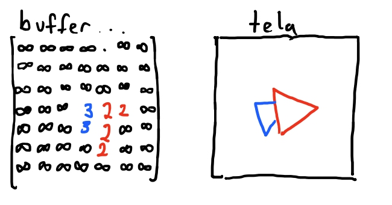

_A imagem acima já mostra a solução que vamos construir a seguir: uma memória com a profundidade de cada pixel, que começa com $$\infty$$ e guarda sempre o menor $$z$$ (o ponto mais próximo)._

Então, pra isso, ao inves de saber qual a face esta mais a frente, vamos melhorar um pouco a precisao do algoritmo do pintor e, calcularemos entao, qual _pixel_ está mais a frente ao inves do triangulo inteiro. Para descobrirmos isso, vamos usar a nossa função de `lerp`!
E para isso, nós estamos ainda iterando sobre o eixo $$y$$ do triangulo, de baixo para cima. Então nossa variavel $$y$$ é a nossa variavel independente. E queremos saber, para cada $$y$$, qual é o valor da $$z$$ coordenada respectiva daquela $$y$$-coordenada. E então, teremos um _buffer_, isto é, uma memoria para cada pixel da tela. E entao, para cada pixel vamos computar qual a distancia em $$z$$ da camera. Caso seja menor do que estava salvo no buffer para aquele pixel, atualizamos o buffer com o novo valor e pintamos aquele pixel. Do contrario, o pixel colorido ja é o mais proximo da camera.

Esta técnica é conhecida como [z-buffering](https://pt.wikipedia.org/wiki/Z-buffer).

Vamos precisar interpolar em $$z$$ para cada $$y$$ pois o triangulo pode ter alguma rotação em algum eixo.

Imaginando o nosso cubo de exemplo do capítulo de projeção, com a face da frente em $$z = 3$$ e a de trás em $$z = 4$$, e usando os triângulos $$EFH$$ (atrás) e $$ABD$$ (na frente), teríamos como exemplo os seguintes pontos após as equações de projeção:

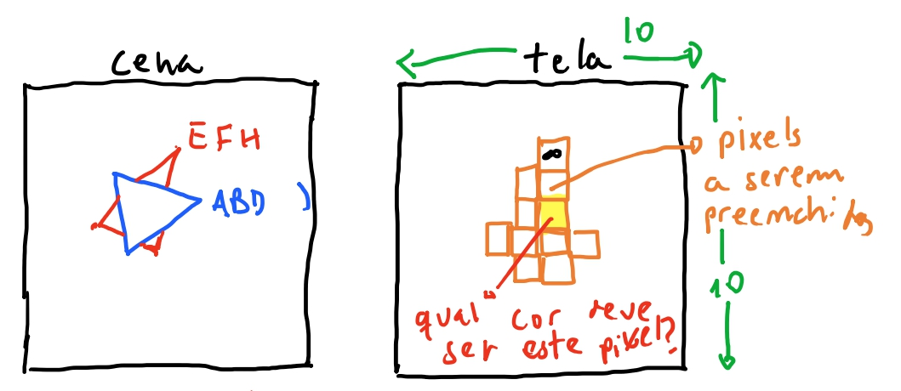

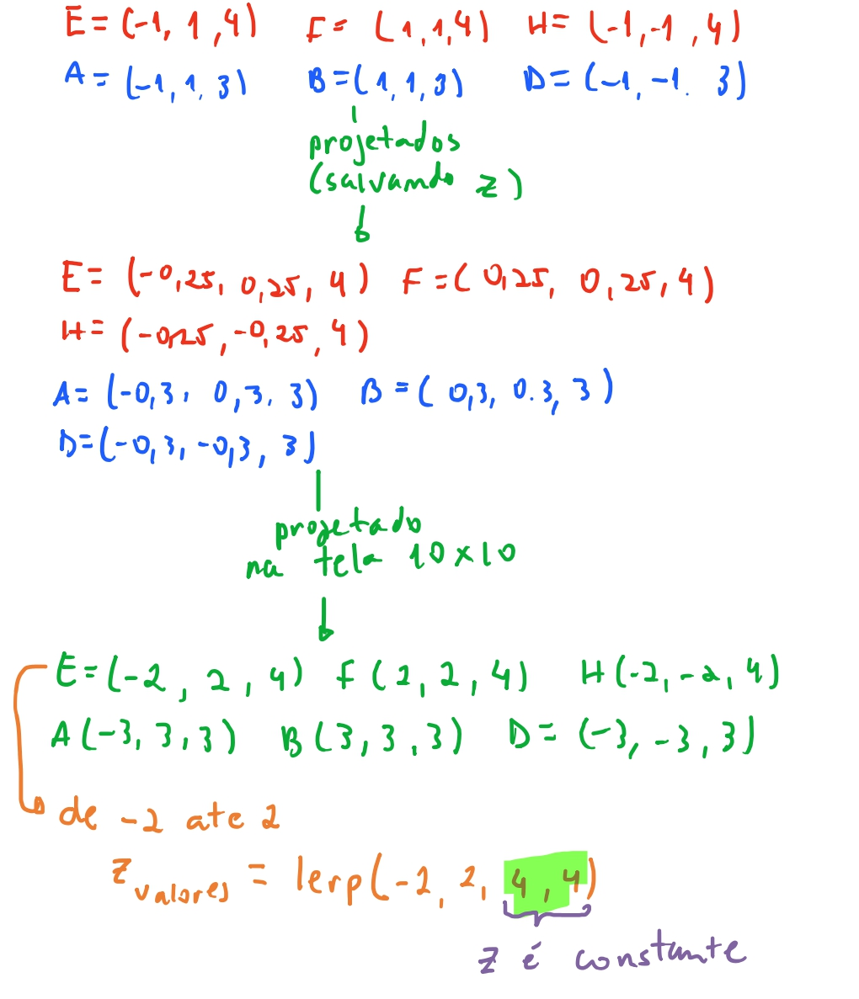

_(Na imagem acima, $$-0.25 \cdot 10 = -2.5$$ aparece como $$-2$$; arredondando para baixo, como combinamos, seria $$-3$$.)_

Como não houve nenhuma rotação, os triângulos estão paralelos ao plano de projeção, e o `lerp` de $$z$$ é constante: $$4$$ para qualquer ponto de $$EFH$$ e $$3$$ para qualquer ponto de $$ABD$$.
Mas conseguimos pensar no triangulo $$AED$$, que liga a face da frente à de trás.

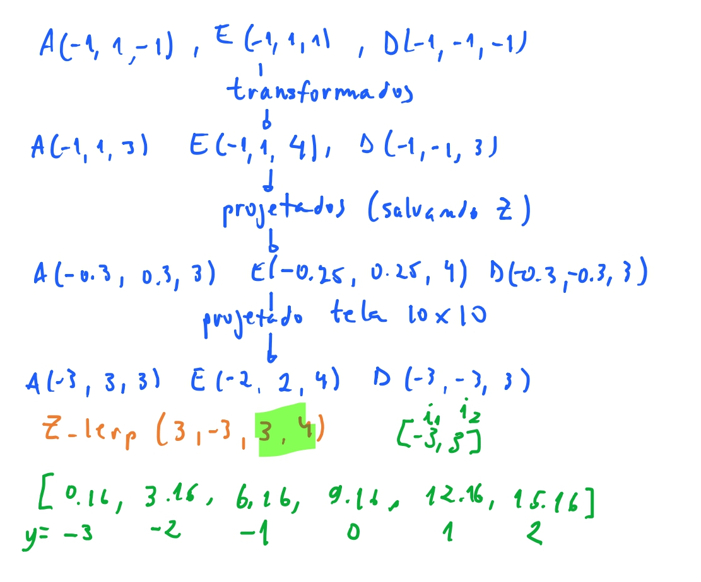

_Correção: as contas da imagem acima estão erradas: a interpolação usa uma aresta que não existe no triângulo, e os valores de $$z$$ deveriam ficar entre $$3$$ e $$4$$. Vamos refazer o raciocínio com uma conta mais simples, na aresta $$\overline{AE}$$._

Os vértices são $$A = (-1, 1, 3)$$ e $$E = (-1, 1, 4)$$. Projetados (com $$d = 1$$, e multiplicando por $$10$$ para a tela, como na imagem anterior), $$A$$ vai para $$y' = \frac{10}{3} \approx 3.33$$ e $$E$$ vai para $$y' = \frac{10}{4} = 2.5$$. O ponto do meio da aresta, no mundo, é $$M = (-1, 1, 3.5)$$, e ele é projetado em $$y' = \frac{10}{3.5} \approx 2.86$$.

Agora, se interpolarmos $$z$$ linearmente na tela, em $$y' = 2.86$$ (que fica a $$57\%$$ do caminho de $$A$$ até $$E$$) obtemos $$z = 3 + 0.57 \cdot (4 - 3) \approx 3.57$$. Mas o valor verdadeiro é $$3.5$$! A interpolação linear erra, e vamos perceber que é porque a relação entre $$y'$$ e $$z$$ não é linear!

Vamos investigar o porque! Vamos tentar calcular qual o valor de $$z$$ em relação ao ponto $$(x', y')$$ no plano de projeção. Sabemos que a equação do plano é dada por $$Ax + By + Cz + D =0$$. E sabemos que para qualquer ponto no nosso mundo, projetamos este ponto $$(x, y, z)$$ no nosso plano de projeção com as equações : $$x' = \frac{x * d}{z}$$ e $$y' = \frac{y * d }{z}$$. Então vamos ver qual a relação do ponto projetado, com a coordenada $$z$$.

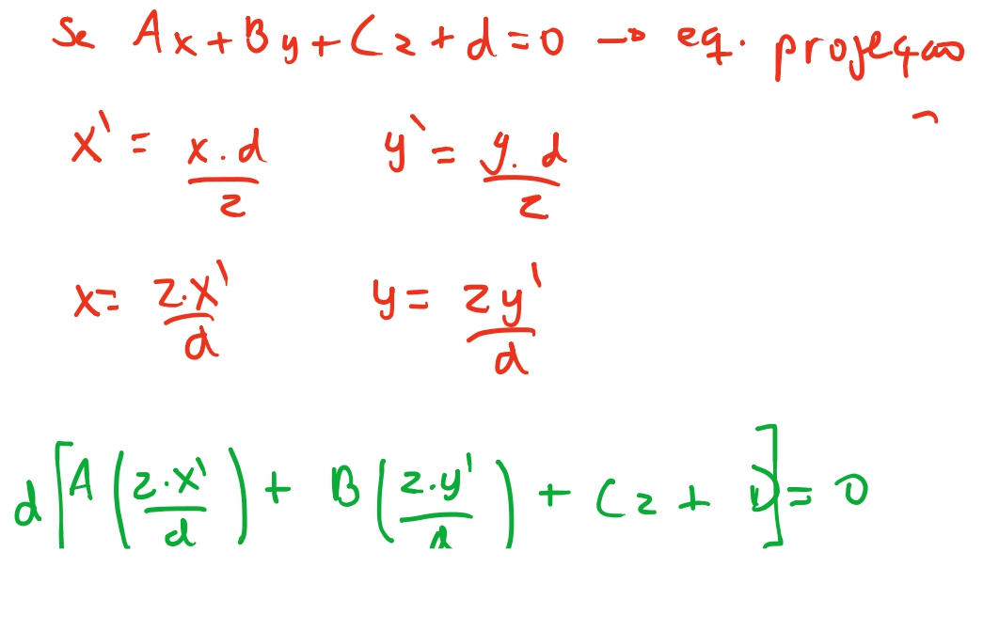

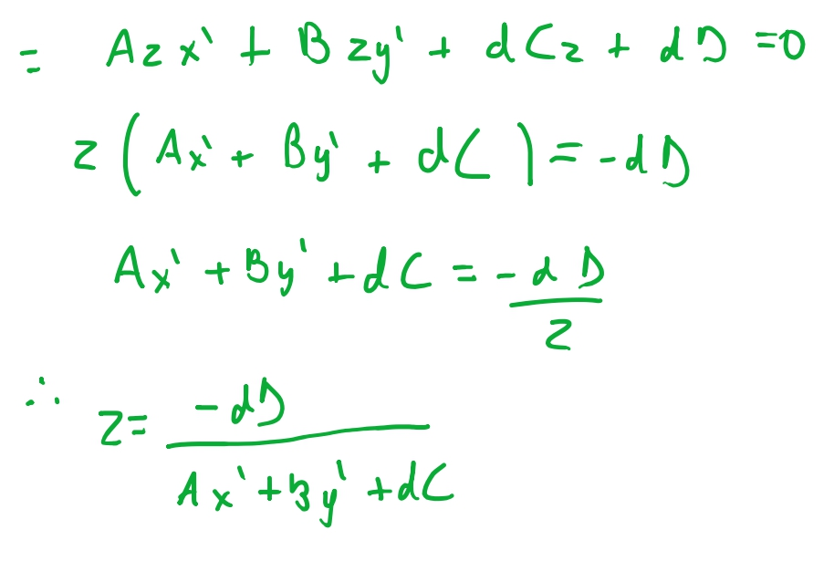

_Obs: na primeira das duas imagens acima, o rótulo "eq. projeção" se refere à equação do plano. E a constante que aparece como $$d$$ minúsculo dentro da equação do plano é o $$D$$ de $$Ax + By + Cz + D = 0$$, e não a distância $$d$$ do plano de projeção._

Então podemos ver que, a relação entre os pontos projetados e $$z$$ original é $$ z = \frac{-dD}{Ax'+ By' + dC}$$. E o que faz sentido: quando projetamos, o ponto no plano de projeção é inversamente proporcional ao eixo $$z$$. Porem esta não é uma equação linear.
Se nós desenharmos o gráfico de $$z$$ teremos a seguinte figura tridimensional:


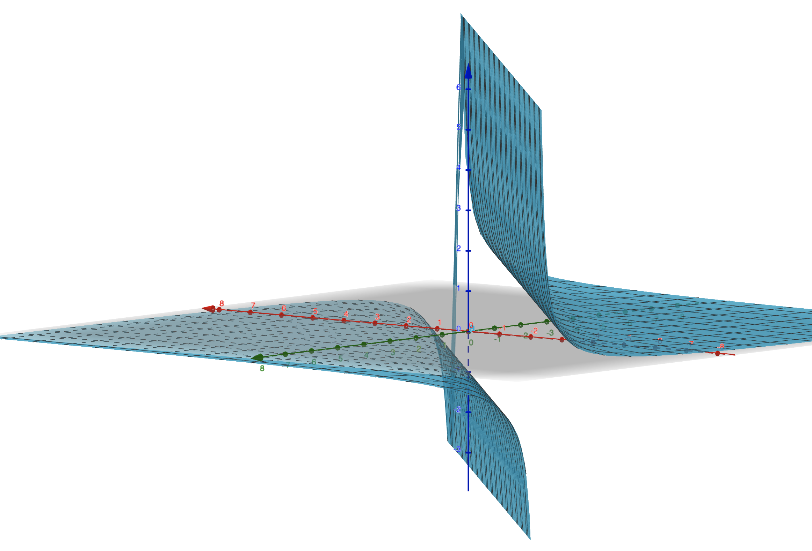


O que claramente não é linear! Como não é linear, se tentarmos interpolar linearmente $$z$$ não vamos chegar proximo dos valores reais. Mas, conseguimos perceber que o comportamento da inversa, $$\frac{1}{z}$$ é linear:

$$\frac{1}{z} = \frac{Ax' + By' + dC}{-dD}$$

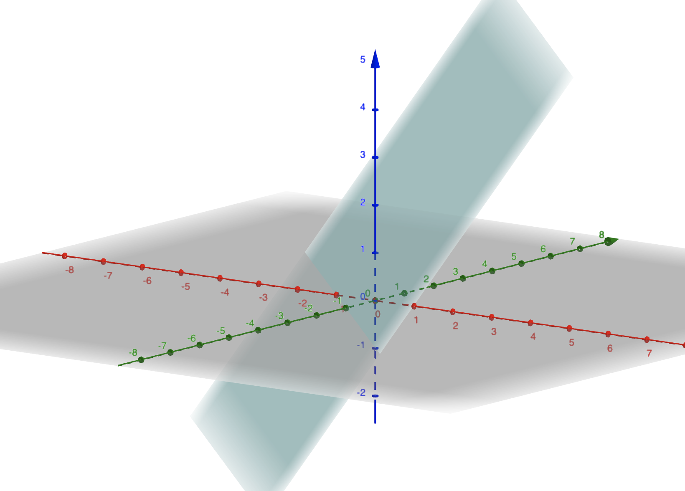

Voltando ao exemplo da aresta $$\overline{AE}$$: interpolando $$\frac{1}{z}$$ em $$y' = 2.86$$ temos $$\frac{1}{3} + 0.57 \cdot (\frac{1}{4} - \frac{1}{3}) \approx 0.2857$$, e $$\frac{1}{0.2857} = 3.5$$. Exatamente o valor certo!

Então ao inves de usarmos $$z$$ para interpolar, vamos usar $$\frac{1}{z}$$ e vamos conseguir interpolar linearmente. Então a alteração em nosso algoritmo de $$z$$-buffer vai funcionar ao contrario: Vamos iniciar todas as posições do nosso buffer com $$0$$ e vamos comparar o valor com o inverso, ao inves de compararmos se o valor interpolado é menor, checaremos se o valor é maior do que o salvo no buffer.

Vamos ver a implementação

{% include pseudocode.html id="5" code="
\begin{algorithm}
\caption{PrencherTriangulo, onde teremos um buffer global chamado zBuffer, iniciado com 0}
\begin{algorithmic}
\PROCEDURE{PreencherTriangulo}{$V1, V2, V3$}
  \STATE $V1, V2, V3$ $\leftarrow$ \CALL{Ordenar}{$V1, V2, V3$} por $y$
  \STATE $X_{valores}\overline{V1V2} = $ \CALL{LERP}{$V1.y, V2.y, V1.x, V2.x$}
  \STATE $X_{valores}\overline{V2V3} = $ \CALL{LERP}{$V2.y, V3.y, V2.x, V3.x$}
  \STATE $X_{valores}\overline{V1V3} = $ \CALL{LERP}{$V1.y, V3.y, V1.x, V3.x$}

  \STATE $iz_{valores}\overline{V1V2} = $ \CALL{LERP}{$V1.y, V2.y, \frac{1}{V1.z}, \frac{1}{V2.z}$}
  \STATE $iz_{valores}\overline{V2V3} = $ \CALL{LERP}{$V2.y, V3.y, \frac{1}{V2.z}, \frac{1}{V3.z}$}
  \STATE $iz_{valores}\overline{V1V3} = $ \CALL{LERP}{$V1.y, V3.y, \frac{1}{V1.z}, \frac{1}{V3.z}$}

  \STATE juntar $\overline{V1V2}$ e $\overline{V2V3}$ em $\overline{V1V2V3}$ (para $x$ e para $iz$), como antes
  \STATE meio = \CALL{size}{$X_{valores}\overline{V1V3}$} $ \div 2$

  \IF{$X_{valores}\overline{V1V2V3}[meio] < X_{valores}\overline{V1V3}[meio]$}
    \STATE $x_{esquerda}, iz_{esquerda}$ = valores de $\overline{V1V2V3}$
    \STATE $x_{direita}, iz_{direita}$ = valores de $\overline{V1V3}$
  \ELSE
    \STATE $x_{esquerda}, iz_{esquerda}$ = valores de $\overline{V1V3}$
    \STATE $x_{direita}, iz_{direita}$ = valores de $\overline{V1V2V3}$
  \ENDIF

  \FOR{$y = V1.y$ \TO $V3.y$}
    \STATE $linha = y - V1.y$
    \STATE $iz_{Scan} = $ \CALL{LERP}{$x_{esquerda}[linha], x_{direita}[linha], iz_{esquerda}[linha], iz_{direita}[linha]$}
    \FOR{$x = x_{esquerda}[linha]$ \TO $x_{direita}[linha]$}
      \STATE $iz = iz_{Scan}[x - x_{esquerda}[linha]]$
      \IF{$zBuffer[x][y] < iz$}
        \STATE \CALL{ponhaPixel}{$x, y$}
        \STATE $zBuffer[x][y] = iz$
      \ENDIF
    \ENDFOR
  \ENDFOR

\ENDPROCEDURE
\end{algorithmic}
\end{algorithm}
" %}

Ou seja, nesta ultima versão atualizada do algoritmo vamos interpolar linearmente $$\frac{1}{z}$$ em relação a variavel independente $$y$$. Com isso saberemos qual o $$z$$-coordenada de cada $$y$$ coordenada pertecente ao triangulo que está sendo preenchido. Quando formos iterear sob cada linha do triangulo, vamos novamente computar qual o $$z$$-coordenada de cada pixel chamando `LERP(x_mais_a_esquerda, x_mais_a_direita, z_mais_a_esquerda, z_mais_a_direita)`. Dessa forma vamos saber quais os valores de $$z$$ para cada pixel. Então vamos conseguir atualizar nosso `z-buffer` para cada pixel. E se o $$\frac{1}{z}$$ computado for maior que o salvo no buffer para aquele pixel (ou seja, se o ponto estiver mais perto da câmera), então colorimos.

Segue uma implementacão que ja conseguimos desenhar as faces:



## E as faces ocultas?

O algoritmo de z-buffering nos garante que, em cada pixel, fica a cor da face mais próxima da câmera, não importa a ordem em que os triângulos forem desenhados.
Porem, ainda há um excesso de trabalho pois os triangulos que estao nas faces "ocultas", isto é, as faces que estão atras dos triangulos desenhados tambem são desenhados, porem, no fim, são redesenhados por cima pelos triangulos mais proximos. Porem conseguimos pensar em um algoritmo que evita esse retrabalho e evitar esse disperdício de computação com um pouco de algebra linear.

Para removermos as faces ocultas vamos usar algumas propriedades de algebra linear. Primeiro vamos descrever a ideia: O que queremos é saber quais são as faces que estao voltadas na direção da camera. As demais faces não vao estar voltadas para a camera vamos ignorar. Então vamos imaginar que conseguimos ter uma seta em cada face do poligono apontando na direção em que ela esta voltada.

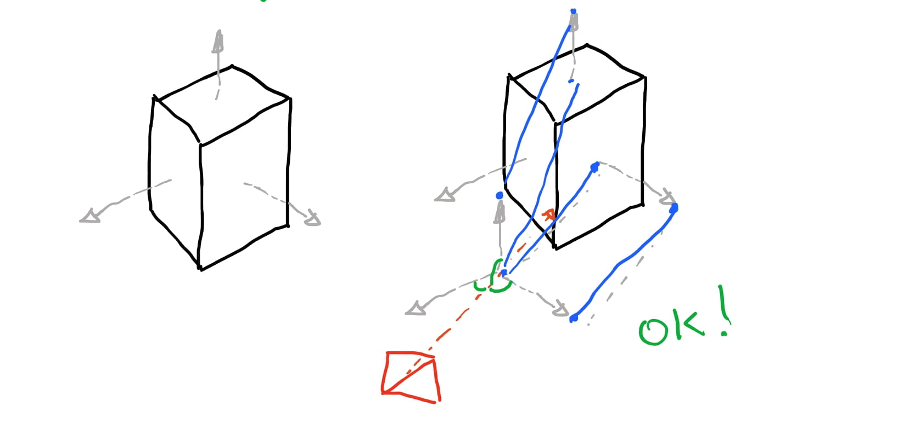

Então imagine também uma "seta" que sai da face e aponta para a câmera. Se o ângulo entre essa seta e a seta da face for menor que $$90$$ graus, significa que essa face está voltada para a câmera. Caso contrário, ela está de costas, e portanto a nossa câmera não está vendo esta face.

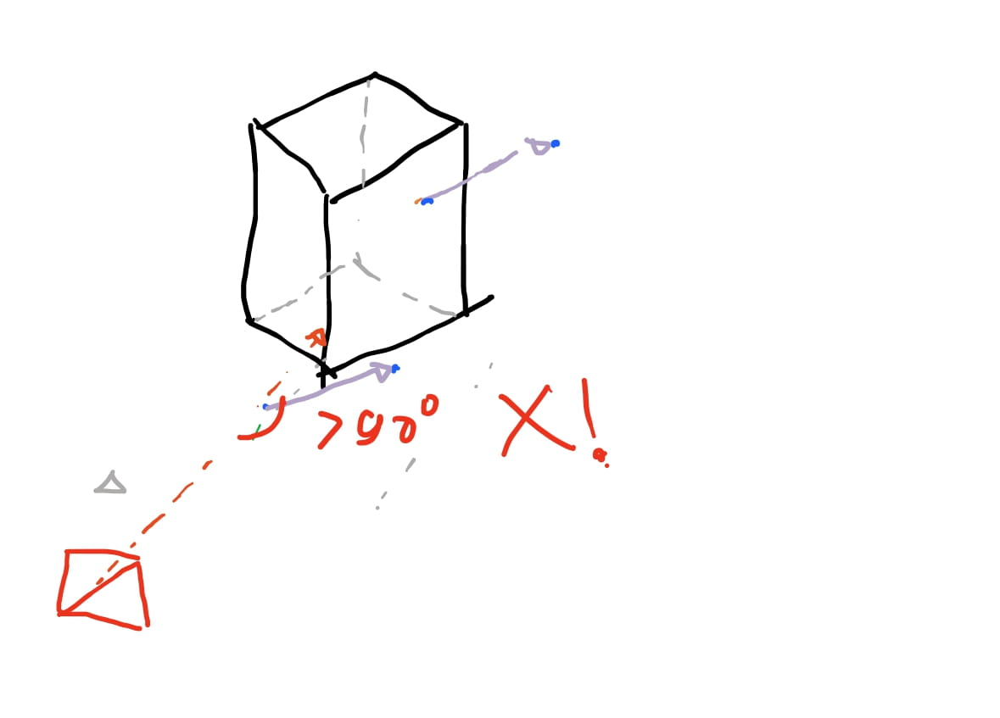

Felizmente conseguimos obter essas "setas" e calcular os angulos entre as retas e vetores com certa facilidade. Podemos obter vetores como vimos nos textos poassados subtraindo um ponto de outro ponto. Podemos então para cada triangulo do nosso cubo obter quais são os vetores da face do triangulo. Imaginando nosso triangulo $$ABC$$, podemos obter os vetores $$AB = B - A$$, $$AC = C - A$$ e $$BC = C - B$$.

Em algebra linear existe uma operação que dado dois vetores nos dá qual o plano que contem ambos os vetores. O resultado dessa operação é um vetor que é ortogonal aos dois vetores ao mesmo tempo. Esta operação é chamada de `cross product` , ou produto vetorial. Então temos o vetor perpendicular a face do triangulo. Agora precisamos saber como medir o angulo entre esse vetor e o vetor da camera.

Conseguimos medir o angulo de dois vetores com o `dot product`, ou produto escalar de dois vetores. A ideia do produto escalar é bem simples: dado dois vetores, quando projetaoms um ao outro, o vetor projetado é um multiplo de $$cos \theta$$. Então conseguimos saber qual o angulo entre dois vetores usando o produto escalar dos dois vetores. Se o produto escalar dividido pelo produto das magnitudes dos dois vetores (ou seja, o cosseno do ângulo entre eles) for negativo, o ângulo é maior que $$90°$$, e sabemos que esta face está voltada para longe da câmera.

Vamos ver melhor como isso funciona:

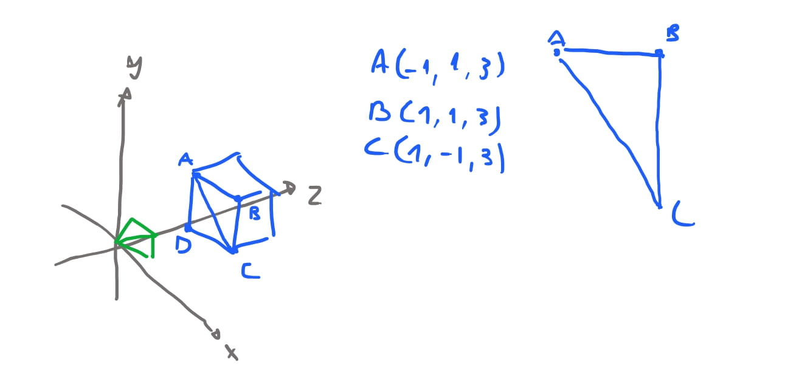

Vamos novamente usar nosso cubo base depois de ser transladado em nossa cena, mas antes de ser projetado. Com a ideia que apresentamos acima, queremos então computar qual é o vetor do plano do triangulo $$ABC$$ de uma das faces do cubo.

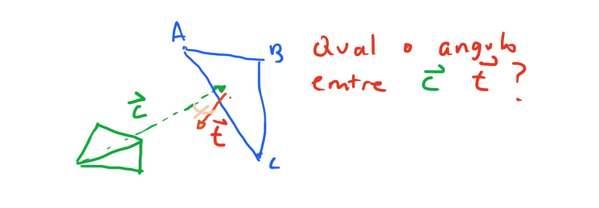

Então queremos calcular o vetor que vai da face $$ABC$$ até a câmera, e calcular o ângulo entre ele e o vetor da face. Para calcularmos o vetor da face do triangulo $$ABC$$ vamos usar o produto vetorial. O produto vetorial resulta em um novo vetor perpendicular aos dois vetores que foram computados. Então nós precisamos encontrar dois vetores que estao no triangulo. Para isso podemos usar as arestas dos triangulos como vetores. O vetor $$\vec{AB}$$ pode ser obtido como vimos acima, $$\vec{AB} = B - A$$. E, similarmente, $$\vec{AC} = C - A$$. Se fizermos o produto vetorial $$ \vec{AB} \times \vec{AC} = \vec{n}$$, $$\vec{n}$$ é o vetor perpendicular a $$\vec{AB}$$ e $$\vec{AC}$$ simultaneamente. Esse vetor perpendicular à face é chamado de *normal* da face.

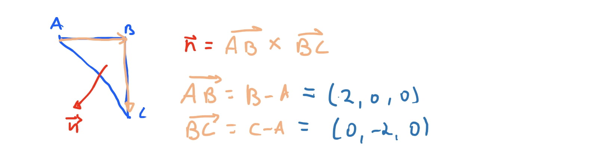

Para calcularmos o vetor entre o triângulo e a câmera, poderíamos usar qualquer vértice do triângulo, mas, para sermos mais precisos, podemos usar o centro do triângulo. Para calcularmos o centro do triângulo podemos fazer uma média das componentes de cada vértice e encontrar o ponto médio do triângulo, também chamado de baricentro.

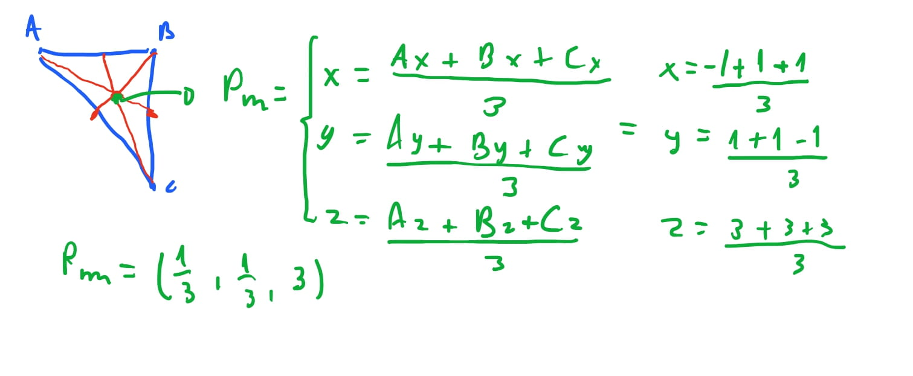

Assumimos que a nossa camera se encontra na origem $$O(0,0,0)$$, e o baricentro do triangulo $$ABC$$ é o ponto $$(\frac{1}{3}, \frac{1}{3}, 3)$$. Então o vetor que sai do baricentro e vai até a câmera é $$\vec{PmC} = O - Pm = (-\frac{1}{3}, -\frac{1}{3}, -3)$$.

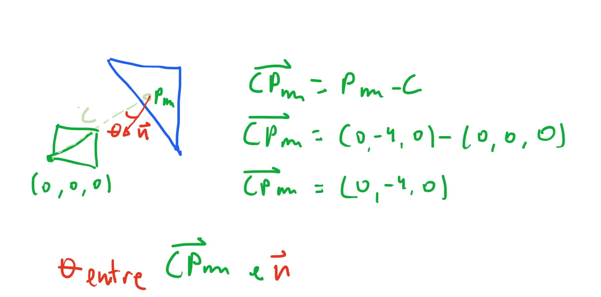

_Correção: as imagens acima têm erros de conta. Os valores corretos são $$\vec{AC} = C - A = (2, -2, 0)$$, $$\vec{n} = \vec{AB} \times \vec{AC} = (0, 0, -4)$$ (a normal aponta para $$-z$$, ou seja, sai da face em direção à câmera) e $$\vec{PmC} = (-\frac{1}{3}, -\frac{1}{3}, -3)$$. As imagens também desenham o vetor no sentido câmera → face; aqui usamos face → câmera, que é o sentido em que "cosseno positivo" significa "face visível"._

Como podemos computar qual o angulo entre $$\vec{PmC}$$ e $$\vec{n}$$ ? O produto escalar entre dois vetores funciona como a "projeção" de um vetor sob o outro. E essa projeção é proporcional ao $$\cos$$ do angulo formado entre os dois vetores.

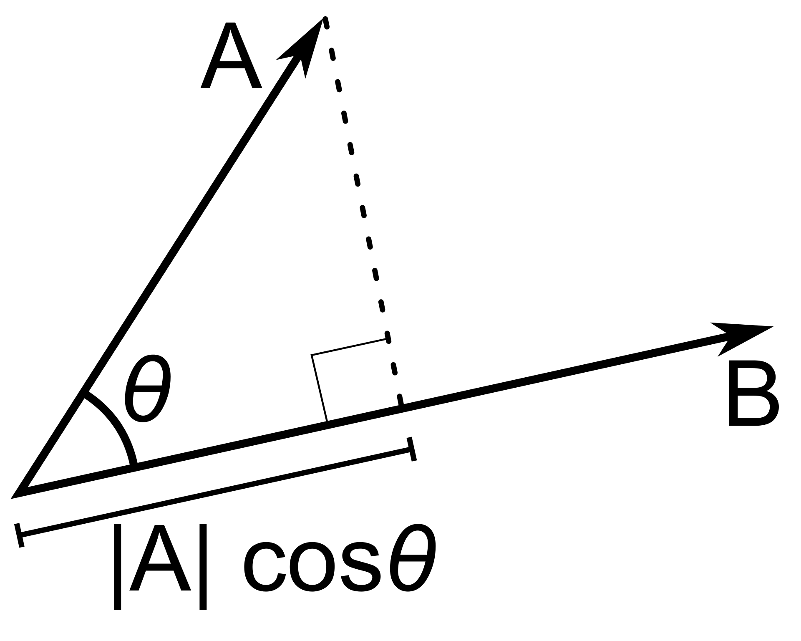

Então dado dois vetores $$\vec{A}$$ e $$\vec{B}$$, o produto escalar é $$\vec{A} \cdot \vec{B} = \left\Vert \vec{A} \right\Vert \left\Vert \vec{B} \right\Vert \cos \theta $$, onde $$\left\Vert \vec{A} \right\Vert$$ é a magnitude, isto é, o comprimento do vetor $$\vec{A}$$.
Isso significa que conseguimos saber o valor do $$\cos$$ do angulo formado entre dois vetores. Poderiamos obter o angulo com a função inversa do $$\arccos$$, porem, conseguimos saber apenas com o $$\cos$$ se o vetor esta em um intervalo esperado. Assim, conseguimos obter que, seja $$\theta$$ o angulo entre os vetores $$\vec{n}$$ e $$\vec{PmC}$$, temos  $$\cos \theta = \frac{ \vec{PmC} \cdot \vec{n} }{ \left\Vert \vec{n} \right\Vert \left\Vert \vec{PmC} \right\Vert } $$.

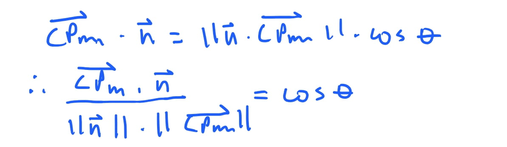

_(Na imagem acima, o denominador deveria ser $$\left\Vert \vec{n} \right\Vert \cdot \left\Vert \vec{CPm} \right\Vert$$, o produto das duas magnitudes.)_

No nosso exemplo: $$\vec{PmC} \cdot \vec{n} = (-\frac{1}{3}) \cdot 0 + (-\frac{1}{3}) \cdot 0 + (-3) \cdot (-4) = 12$$, $$\left\Vert \vec{n} \right\Vert = 4$$ e $$\left\Vert \vec{PmC} \right\Vert = \frac{\sqrt{83}}{3} \approx 3.04$$. Logo $$\cos \theta \approx \frac{12}{4 \cdot 3.04} \approx 0.99$$.

Com isso conseguimos inferir o seguinte: Se o $$\cos \theta > 0$$, ou seja, positivo, implica que a face do triangulo está na direção da camera. Caso $$\cos \theta < 0 $$ implica que a face do triangulo está apontando na direção oposta da camera, e portanto, não é possivel ve-la. No nosso exemplo, $$\cos \theta \approx 0.99 > 0$$: a face $$ABC$$ está voltada para a câmera, como esperávamos para a face da frente do cubo.

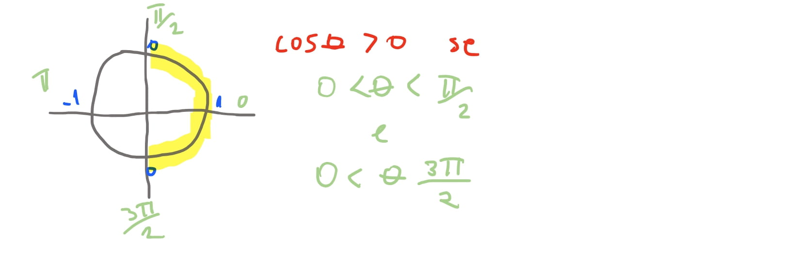
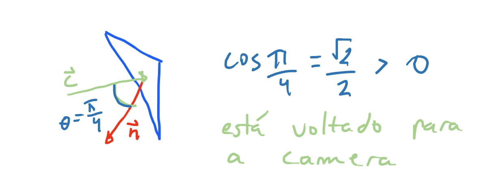
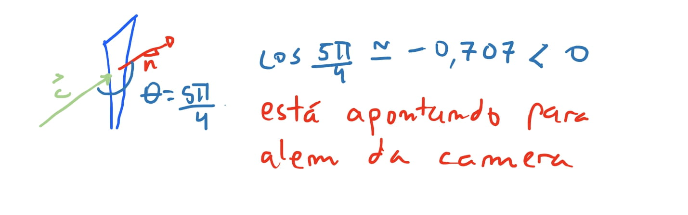

_Obs: o ângulo entre dois vetores fica sempre entre $$0$$ e $$\pi$$, então basta olhar se $$\theta < \frac{\pi}{2}$$ (cosseno positivo); um ângulo como $$\frac{5\pi}{4}$$ não acontece. E, como nas imagens anteriores, o vetor $$\vec{c}$$ está desenhado no sentido câmera → face: é com o vetor no sentido face → câmera, como no texto, que "ângulo menor que $$90°$$" significa "face visível"._

E isso faz aparecer uma propriedade importante: Como precisamos computar os vetores com as arestas dos triangulos, $$\vec{AB}$$, $$\vec{BC}$$ ...etc, então é esperado a mesma ordem dos vertices seja dada. Podemos usar o padrao de que os vertices do modelo sejam definidos no sentido horario para todos os triangulos, imaginando que, a face esteja na direção da camera. Exemplo:

```
triangulo 1 : ABC
triangulo 2 : ACD
triangulo 3 : BGC
triangulo 4 : BFG
...
```

Chamamos atenção para este detalhe pois cada ferramenta de modelagem pode usar uma ordenação diferente, e desta forma, os vetores perpendiculares dos triangulos podem ser computados na direção oposta. E portanto o algoritmo acima iria remover as faces visiveis e mostraria as faces ocultas, resultando no efeito oposto ao esperado. E portanto, deve-se conhecer qual a ordenação dos vertices que cada ferramenta usa para definir os triangulos da malha dos modelos.

Então nosso pseudocodigo ficaria da seguinte forma: Vamos passar em nossa cena e filtrar quais faces estão acessíveis para a camera. As que estiverem, vamos mandar para nosso algoritmo de preencher triangulos.

{% include pseudocode.html id="7" code="
\begin{algorithm}
\caption{Recebe a malha de triangulos em coordenada de mundo, e a camera, e retorna quais sao os triangulos visiveis a partir da posicao da camera}
\begin{algorithmic}
\PROCEDURE{RecortaTriangulos}{$mesh, camera$}

\STATE $triangulos_{visiveis} = $[]


\FOR{cada triangulo em mesh}
  \STATE $\vec{AB} = triangulo_b - triangulo_a$
  \STATE $\vec{AC} = triangulo_c - triangulo_a$

  \STATE $normal_{triangulo} = \vec{AB} \times \vec{AC} $
  \STATE $baricentro = Vetor(\frac{x_A + x_B + x_C}{3}, \frac{y_A + y_B + y_C}{3}, \frac{z_A + z_B + z_C}{3} )$
  \STATE $\vec{BaricentroCamera} = camera -  baricentro$

  \STATE $cos_{baricentro \angle camera } = \vec{BaricentroCamera} \cdot normal_{triangulo}$ \COMMENT{só o sinal importa, então não dividimos pelas magnitudes}

  \IF{$cos_{baricentro \angle camera} > 0$}
    \STATE $triangulos_{visiveis}$.push(triangulo)
  \ENDIF
\ENDFOR

\RETURN $triangulos_{visiveis}$
\ENDPROCEDURE
\end{algorithmic}
\end{algorithm}
" %}

E então chamamos para preencher apenas os triangulos recortados por `RecortaTriangulos`.

Abaixo segue nossa implementação de ambos os algoritmos, tanto `z-buffer` quanto `face-culling`.



## Referências

- Gabriel Gambetta, [*Computer Graphics from Scratch: A Programmer's Introduction to 3D Rendering*](https://gabrielgambetta.com/computer-graphics-from-scratch/), No Starch Press, 2021. A sequência desta série segue de perto a parte de rasterização desse livro, que pode ser lido de graça online.
- James D. Foley, Andries van Dam, Steven K. Feiner e John F. Hughes, *Computer Graphics: Principles and Practice*, Addison-Wesley. O livro clássico da área, para quem quiser se aprofundar em cada um dos tópicos da série.
