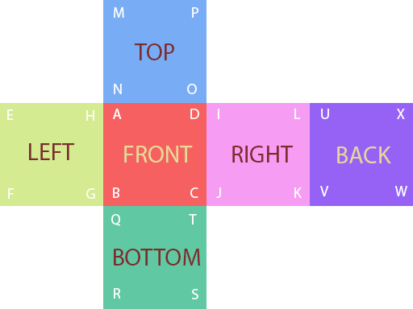



## Sting: um modelo de verdade

Com o mesmo rasterizador, agora lendo um arquivo `.obj`: a Sting, espada do Bilbo, com todas as texturas que vieram com o modelo. Ligue e desligue cada textura, troque o tipo de iluminação e ande pela cena com os botões (ou W A S D, Q e E). Como tudo é calculado na CPU, pixel a pixel, cada passo leva um instante para ser desenhado.


